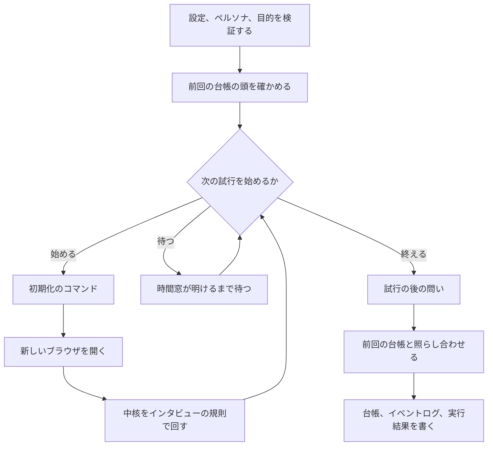

# インタビューのモード

インタビューのモード(`webqa interview`)は、ユーザーインタビューの代わりに、ペルソナを持たせた判断モデルに画面を触らせる。
見つけた課題は、AIがそのまま直せる指示の台帳として、Markdownに書き出す。
この文書は、このモードの入力、試行の進め方、課題の見つけ方、台帳の形、再実行での照らし合わせをまとめる。

## 目的

実際の利用者に画面を触ってもらうと、3種類の課題が分かる。
1つ目は判断に迷うところで、次に何を押すか分からない、似たボタンが並ぶ、ラベルから行き先が想像できない、などが当たる。
2つ目は視認性の悪いところで、文字が読みにくい、大事なボタンが目立たない、要素が埋もれている、などが当たる。
3つ目は、画面の目的にたどり着かないところである。
ECなら注文、SNSなら投稿や交流のように、画面には利用者にしてほしい行動がある。
その行動に届かないことや、その行動をしたくなる流れになっていないことが当たる。

インタビューは手間がかかり、何度も回せない。
このモードは、ペルソナを決めた判断モデルに同じことをさせ、課題を何度でも洗い出せるようにする。

結果を読むのは開発者だが、実際に直すのはAIであることが多い。
そこで、課題を直す指示の形で台帳に書く。
利用者は台帳から直す課題を選んでAIに渡し、直したあとに再実行して確かめる。
この「実行する、選ぶ、直す、確かめる」の輪を回せることが、このモードの目的である。

このモードは、利用者のニーズや動機は調べない。
「この機能が欲しいか」は人に聞く。
見つけた課題をソースコードの場所に結び付けることもしない。
台帳には画面の要素の手がかりまでを書き、コードを探すのは直す側のAIに任せる。
課題を自動で直すこともしない。

## ペルソナから外れないこと

ペルソナがしないはずの考えや操作から出た報告は、役に立たないどころか害になる。
報告の数が多くても、こうした報告が混ざっていれば失敗である。
そのため、ペルソナから外れないことを、このモードの中心の要件にする。

目的のずれを除くすべての課題は、試行を終えたあとに、このペルソナにとって自然かを判断モデルに確かめる(目的のずれは、ずれの問いで確かめる)。
自然でないと判断した課題は、台帳の本体に入れず、別の区分に分ける。
各課題には、ペルソナのどの性質からその課題が起きたかも書く。
開発者と直す側のAIが、課題がペルソナに合っているかを自分で確かめられるようにするためである。
確かめ方は[試行の後の問い](#試行の後の問い)に書いた。

## ほかのモードとの関係

インタビューのモードは、3つ目の実行のモードである。
各試行は、規則の`mode`をインタビューにして中核を回す。
段階は目的の1つだけで、中核は段階の進め方と終わり方を決め打ちシナリオと同じに扱う。
違うのは行き詰まりの数え方だけである。
スクロールで新しく見えた要素を進展に数えず、ガードレールが止めた提案を進展の無いステップに数える。
探索モードと決め打ちシナリオモードの振る舞いは、このモードに合わせて変えない。

次のものは、ほかのモードとそのまま共有する。

- ガードレール(禁止要素、課金画面、低確信度の`back`、要素の同一性、許可ドメイン)
- 負荷制御と判断予算、時間切れ、利用者による中断
- 段階とdone_when、固まりの判定、行き詰まりの閾値での終わり方、終了の優先順位
- 機密情報を伏せる処理、設定の読み込みと検証、問題の検出とイベントログ

ガードレールと負荷制御は[safety.md](safety.md)、段階とdone_whenは[scenario-mode.md](scenario-mode.md)にある。
行き詰まりの回数の数え方だけは共有しない。
違いは[中核の状態機械](core.md)のカウンタの節にある。
低確信度の`back`の閾値は、`limits`ではなく`interview.back_confidence`を使う。

このモードで変わるのは、判断モデルへの問いの中身、候補の選び方、課題の検出、出力である。
試行の外のループが中核に渡す値(時刻の起点、時間窓の上限、期限)も、このモードで決める。
判断モデルの抽象のうち、このモードだけが使うのは、自由な文で答える問いの種類と、スクリーンショットを添えて問う口である。
抽象の全体は[judge.md](judge.md)にある。

## 全体の流れ

1回の実行は、1つのペルソナと1つの目的の組を、設定の回数だけ試す。
結果は1冊の台帳にまとめる。



設定や文書に誤りがあるときと、前回の台帳を読めないときは、ブラウザを開く前に設定エラーで終える。

## 入力

### 設定

設定ファイルの`interview`の節に、このモードの項目を書く。
このモードで`interview`の節が無ければ、設定エラーにする。
設定ファイルの全体は[config.md](config.md)にある。

| 項目 | 既定 | 意味 |
|---|---|---|
| `persona` | 必須 | ペルソナの文書のパス |
| `purpose` | 省略可 | 目的の文書のパス。省くと、判断モデルが目的を推測する |
| `trials` | 3 | 試行の回数。1以上100以下 |
| `hesitation_threshold` | 0.6 | 迷いの度合いがこの値以上なら、迷いの手がかりにする。0より大きく1以下 |
| `confidence_threshold` | 0.5 | 選んだ操作の確信度がこの値未満なら、迷いの手がかりにする。0より大きく1以下 |
| `back_confidence` | 0.3 | 判断モデルが選んだ`back`に要る確信度。試行では`limits.back_confidence`の代わりに使う。0より大きく1以下 |
| `stuck_threshold` | `limits`の値 | 行き詰まりと見なす、進展の無いステップの数。1以上 |
| `requests_per_hour` | `limits`の値 | 1時間の時間窓の中の、対象サーバーへのアクセスの上限。2以上 |
| `max_natural_questions` | 50 | 試行の後に判断モデルへ問う回数の上限。1以上 |
| `reset.command` | 省略可 | 試行の前に実行する初期化のコマンド。1つ目が実行ファイル、残りが引数 |
| `reset.timeout_secs` | 60 | 初期化のコマンドを待つ秒数。1以上 |

`back_confidence`は、省いても`limits`の値を継がない。
ペルソナが迷って引き返すことは、このモードで見つけたい振る舞いだからである。
探索モードの値のままでは、迷った`back`がガードレールで止まり続ける。

設定エラーの文には、誤った項目の名前を入れる。
ファイルの中身、パス、コマンドの引数は入れない。

### ペルソナの文書

ペルソナは、決まった形式のYAMLの文書で渡す。
`webqa`は読み込むときに形式を検証し、誤りがあれば設定エラーにする。
知らない項目があっても誤りにする。

| 項目 | 中身 |
|---|---|
| `name` | 呼び名 |
| `profile` | どんな人か(属性、使う場面) |
| `it_literacy` | ITの慣れ(用語をどこまで知っているか) |
| `wants` | このサービスで達成したいこと |
| `avoids` | 知らないこと、しないことの一覧。1つ以上 |

どの項目も必須で、空白だけの値も書いていないものとして扱う。
検証は表の順に進め、最初に見つけた欠けを返す。

```yaml
name: 佐藤さん
profile: 60代。孫に頼まれて、週末にスマートフォンで買い物をする
it_literacy: スマートフォンの基本操作だけ。「カート」の意味は知っている
wants: 孫の誕生日プレゼントを注文する
avoids:
  - URLを手で打たない
  - 「SKU」のような略語を知らない
```

### 目的の文書

目的は「この画面で利用者にしてほしい行動」である。
利用者が目的の文書に書くことも、書かずに判断モデルに推測させることもできる。

| 項目 | 中身 |
|---|---|
| `goal` | ペルソナが目指すことを1文で書く |
| `done_when` | 目的に届いたと見なす条件。`url`、`element`、`text`のどれかを1つ以上書く |
| `screens` | 画面ごとの目的の一覧。各項目は`url`(パスの型)と`purpose`(その画面の役目)を持つ |

`goal`と`done_when`は組で書く。
片方だけを書くと設定エラーにする。
`screens`だけを書くと、目的そのものは推測させ、画面ごとの目的だけを渡す。
`done_when`も`screens`も無い文書は、設定エラーにする。

`screens`の`url`は、`/`で始まるパスの型である。
`*`だけの区切りは、空でない任意の1区切りに合う。
クエリと`fragment`は比べない。
型は、URLのパスと同じ`%`の符号化にそろえて、区切りの列にして持つ。
区切りの列が前の項目と同じ型を書くと、設定エラーにする。
たとえば`/検索`と`/%E6%A4%9C%E7%B4%A2`は同じ型で、`/products/*`と`/products/`は別の型である。

目的の行動そのもの(注文の確定、投稿の送信など)は、ガードレールの禁止要素に当たることが多い。
禁止要素は、このモードでも押さない。
そのため、`done_when`は「確定の操作ができる画面まで来た」で書く。
確定の後の画面(完了の画面)の課題は、このモードでは見つからない。

```yaml
goal: 注文を確定できる画面まで進む
done_when:
  url: /order/confirm
screens:
  - url: /products/*
    purpose: 商品をカートに入れる
```

目的を推測させるときは、中核に渡す段階のゴールを「画面から、この画面で利用者にしてほしい行動を推測し、ペルソナとしてそれに向かう」にする。
この段階のdone_whenは、決して満たされない条件にする。
そのため、推測させた試行は、判断モデルの終了の申告か、ほかの終わり方で終わる。

### 試行の回数と、試行どうしの独立

1回だけの迷いは偶然のことがあるので、同じ試行を複数回して、何回のうち何回起きたかを台帳に書く。
試行どうしは、互いに影響しないようにする。

- ブラウザは試行ごとに新しく開き、認証状態を入れ直してから開始のURLを開く。
- サーバー側の状態(カートの中身、投稿済みのデータ)は、初期化のコマンドで試行の前に戻せる。
  コマンドの中身(データベースの巻き戻しなど)は利用者が用意する。
  書かなければ何もしない。
- 探索の記憶は、試行ごとに空で始め、保存しない。

## 1つの試行

各試行は、規則の`mode`をインタビューにして中核を回す。
段階は目的の1つだけで、名前は「目的」である。
操作の種類は設定のものを使い、終了の申告(`done`)が無ければ足す。
行き詰まりの閾値は、`interview`の節の値を使う。

### 候補の選び方

探索モードは、未操作の要素から順に選び、網羅を広げる。
インタビューのモードは網羅を目指さず、ペルソナとして目的に向かう操作を判断モデルに選ばせる。
そのため、中核の候補の絞り込みは使わず、ビューポートの中の要素をすべて判断モデルに渡す。
ガードレールは同じく効くので、禁止要素は押さず、許可ドメインの外には進まない。

操作の種類の選択肢は、中核が答えを確かめるときの選択肢と同じものを使う。
そのため、ほかのモードと同じく、禁止要素のある画面では`enter`が選択肢から外れる。
禁止要素と`enter`の扱いは[safety.md](safety.md)の「禁止要素とenter」にある。

### 判断モデルに渡すもの

判断モデルには、アクセシビリティ情報のテキストに加えて、画面のスクリーンショットも渡す。
橋渡しのコマンドは、起動のときに画像を扱えるかを申告する。
同梱の橋渡しは、JEVと自由な文のモデルの両方が画像を読めるときだけ、読めると申告する。
申告の行が無いか解釈できないときは、起動の失敗にする。
判断モデルのアダプタが画像を扱えるかを返す`reads_images`を実装しなければ、既定の値で画像を扱えないものとして扱う。
画像を扱えないときは、スクリーンショットを問い合わせに添えず、見えにくい要素も問わない。
視認性の課題も出さず、そのことを台帳の頭に書く。
スクリーンショットは、画像を扱えるかに関係なく毎ステップ撮る。

スクリーンショットは伏せずに渡すので、画面に出た機密情報も判断モデルへ送られる。
このモードはテスト環境で使う前提である。
探索モードと決め打ちシナリオモードは、テキストだけを渡す。

### 直近の操作

判断モデルに送る画面の文の後ろに、「直近の操作」の節を1回だけ足す。
問いごとの前置きには入れない。問いの数だけ重複するためである。
1ステップの2回の呼び出しには、同じ節が入る。

節は、その試行の中の直近5回の操作を、古い順に1行に1つ並べる。
行は`1. click 「検索」 → 別のページに移った`の形で、操作の種類、対象の要素の名前、操作のあとどうなったかを書く。
名前は、伏せ字と正規化のあとの名前である(数字の連続は`#`、空白は詰める)。制御文字は、画面の行と同じ書き方でエスケープする。
節の全体を伏せ字の処理に通すので、伏せ字の規則が見出しや行番号に当たることがある。
対象の無い操作は「対象なし」と書く。
入力した値とページの本文は書かない。
6回目以降の操作は、古いものから節から落ちる。
試行の最初の操作の前は、節ごと付けない。前の試行の操作も入れない。

操作のあとどうなったかは、次の4通りで書く。

| 書き方 | 当たるとき |
|---|---|
| 別のページに移った | URLが違う |
| 同じページで表示が変わった | URLは同じで、表示領域の文が違う。スクロールはこれに当たる |
| 画面は変わらなかった | URLも表示領域の文も同じ |
| 止められた(理由) | ガードレールが提案を止めた。操作はしていない |

止められた行は、判断モデルの答えをガードレールが止めたときに足す。
止められた理由は、禁止の要素、確信度が低い、要素が見つからない、のどれかである。
操作の直前に要素を確かめ直して中止したときは、節に書かない。
どちらも、インタビューのモードでは行き詰まりの回数に数える([中核の状態機械](core.md)のカウンタ)。
選択肢からは外さないので、判断モデルは同じ操作を選び直せる。
イベントログと実行結果の形は変えない。
スクロールを続けても、進んでいると判断モデルに受け取らせないために、URLの変化と分けて書く。

最後の操作と同じ操作が、同じ要素に続いていれば、節の最後に回数の行を足す。
行は`直前の操作(scroll_down、対象なし)を14回続けて選んでいる`の形である。
回数は、5行の窓の外も含め、試行の中の操作をさかのぼって数える。
止められた提案も操作として数える。
1回だけなら、この行は付けない。
各行には回数を付けない。

探索モードと決め打ちシナリオの問いは変えない。
中核が自分で行った操作(読み直しや戻り)も、操作の記録にあれば節に入る。

### 問い

毎ステップ、どの問いにもペルソナの説明を前に添え、「この人ならどうするか、どう感じるか」で答えさせる。
説明には、名前、どんな人か、ITの慣れ、達成したいこと、しないこと、目指すことを並べる。

1ステップの問いは、判断モデルへの2回の呼び出しに分ける。
期待を答える人は、自分が選んだ操作を知らなければならない。
1回の問いに入れると、判断モデルは操作を選ぶ前に期待を答えてしまい、操作と食い違う文が返る。
そこで、期待は中核が操作を決めたあとに、その操作を知らせて問う。

1回目は、ほかのモードと共通の4つ(操作の種類、対象の要素、エラーの表示、ゴールの達成。要素が無い画面では対象の要素を問わない)に、次の3つを足して問う。

| 問い | 答え方 |
|---|---|
| 次に何をするかで迷ったか | 迷ったと答える確率を、迷いの度合いとして読む |
| 目的に関わる要素のうち、特に目立って見えにくいもの | 最大3つを、1行に1つ「番号: 理由」の形で書く。番号は画面の一覧の番号。理由は、文字の大きさ、色の薄さ、隠れているなど、見た目に限る。スクリーンショットを添えたときだけ問う |
| この画面は利用者に何をしてもらうための画面だと思うか | 1文の自由な文 |

見えにくい要素の答えは、次のように読む。
全角のコロン、行頭の箇条書きの記号(`-`、`*`、`・`、`•`)、全角の数字を受け付ける。
「番号: 理由」の形として読めない行(前置き、「なし」、コードのフェンス、`3.`、`**3**:`)と、理由が空の行は捨てる。
同じ番号の繰り返しは1つにまとめ、3つを超えた分は切り捨てる。
挙げすぎると、読解の不満まで混ざり、課題が増えすぎて、判断に迷う課題が自然さの問いの上限に届かなくなる。
既知の限界として、`**3**:`、`3.`、`番号3:`、`3番:`、`[3]:`の書き方は読めず、捨てた数もイベントに残さない。

画面の目的の推測は、目的を書いたときも毎ステップ問う。
推測は、画面ごとの目的との比較と、推測させた実行の台帳の頭に使う。

2回目は、期待の問いだけを問う。
問いの文には、中核が行う操作の種類と、対象の要素を入れる。
要素は、画面の一覧の番号と、伏せ字のあとの名前で書く。
要素の無い操作は、対象を「なし」にする。

> あなたは次に『click』をする。対象: 2番「ヘルプ」。この操作で何が起きると期待するか、1文で答える。

操作と要素は、1回目の答えから、中核が実際に行うものを使う。
判断モデルが1位に挙げた要素ではなく、ガードレールを通り、直前に操作して画面が変わらなかった要素を避けたあとの要素である。
選び方は中核のものをそのまま呼ぶので、2回目の問いと実際の操作は食い違わない。
画面と画像は、1回目と同じものを渡す。画像は2回目に撮り直さない。

2回目を問わないのは、中核が操作を行わないときである。
`done`と`stuck`を選んだとき、ガードレールなどで中核が拒否したとき、1回目の答えが使えなかったときが当たる。
このステップの期待は空になり、判断に迷う課題と視認性の課題の期待の欄も空になる。
台帳の指示の文は、期待が空なら`(期待: …)`ごと省き、TUIは空の欄を`-`で見せる。

確定のときの拒否(要素が消えた、別の要素に替わった)は、2回目のあとに起きる。
その場合、期待は問うたが操作はしなかったステップになる。

2回目の答えが欠けているか空のときは、足した問いの答えが使えないときと同じく、応答の異常にして操作しない。

判断予算は、1ステップにつき1回と数え、2回目は数えない。
記録とイベントログには、呼び出しごとに1件ずつ書く([records.md](records.md))。

答えが使えないとき(欠けている、範囲の外、選択肢に無い)は、そのステップを答えの無いステップとして残す。
このモードで足した問いの答えが使えないときは、応答の異常として扱い、操作をしない。
足した問いの答えが使えなかったときは、その問いの名前(`hesitation`、`expectation`、`hard_to_see`、`purpose_guess`)も、応答の異常のイベントの`question`に残す。
`expectation`は2回目の呼び出しの答えが使えなかったときの名前で、それ以外の3つは1回目の名前である。
見えにくい要素の答えが使えないのは、答えそのものが無いときと、送った一覧に無い番号を挙げたときだけである。
ほかのモードと共通の問いの答えが使えないときは、ほかのモードと同じく、その原因を応答の異常として記録する。
答えの無いステップからは、迷いと視認性の課題を出さない。
問題の検出の問いは、ほかのモードと同じく足す。
問題の記録は[records.md](records.md)にある。

### 試行の終わり方

試行の終わり方は、決め打ちシナリオの道筋をそのまま使う。
ただし、行き詰まりの回数の数え方は[中核の状態機械](core.md)のカウンタの節のとおり違う。

| 中核の終了理由 | 試行の結末 | 終えた試行に数えるか | 目的に届かないに数えるか |
|---|---|---|---|
| `goal_achieved` | 目的のdone_whenを満たした | 数える | 数えない |
| `reported_done` | 判断モデルの申告で終えた | 数える | 数えない |
| `stuck`(判断モデルの申告) | ペルソナが諦めた | 数える | 数える |
| `stuck`(進展の無いステップ) | 進めなくなった | 数える | 数える |
| `budget_exceeded` | 判断予算を使い切った | 数える | 数えない |
| `time_exceeded` | 打ち切り | 数えない | 数えない |
| `user_aborted` | 打ち切り | 数えない | 数えない |
| `judge_unavailable` | 打ち切り | 数えない | 数えない |

判断モデルの申告で終えた試行は、目的を推測させたときは「推測した目的に届いた」という申告として記録する。
目的を書いたときは、done_whenを確かめていない終了として記録する。
同じ画面の行き来は、行き詰まりとは別に、迷いの手がかりとして記録する。

実行全体の期限か中断か、判断モデルの失敗の連続で途中で終わった試行は「打ち切り」とする。
打ち切った試行は、終えた試行の数(以下N)にも、目的に届かない試行にも数えない。
判断モデルの失敗が3回続いた試行は、イベントログに結末`judge_down`として書く。
失敗は、ステップの答えで数える。
1ステップで判断モデルを2回呼び、どちらかが失敗すれば、そのステップを1回の失敗と数える。

## 試行の外のループ

試行を繰り返すループは、中核の状態機械の外にある。
対象サーバーへのアクセスの上限は、このループが実行全体で守る。

ループは、次の試行を始めるかを、初期化のコマンドの前に判定する。
判定は、判断モデルの停止、中断、期限、試行の回数、時間窓の順に見る。
直前の試行が判断モデルの失敗の連続で打ち切られたときは、ほかの条件を見ずに、それ以上始めない。
中断されたとき、期限を過ぎたとき、すべての試行を始め終えたときも、それ以上始めない。
判断モデルに届かない間に試行を続けても、同じ失敗を繰り返すだけだからである。
そのため、打ち切りは1回の実行で多くても1回のままである。
期限ちょうどの時刻は、過ぎたものとして扱う。

時間窓は、実行の開始から1時間ずつ区切る。
試行ごとの最初のページの表示も、実行全体の窓のアクセスに数える。
中核に渡す時間窓の上限は、今の窓の残りから最初のページの1を引いた数にする。
その数が`requests_per_hour`の半分を下回れば、試行を始めずに次の窓が明けるまで待つ。
次の窓が明けるのが期限と同時か後なら、待たずに時間切れで終える。
待っても、試行を始める前に期限が来るからである。
待つ間も、中断は効く。

中核には、試行の開始からではなく、実行の開始からの経過時間を時刻として渡す。
そのため、中核の時間窓の区切りは実行全体の時間窓とそろう。
期限も実行の開始から数える。
試行を終えたら、中核の窓で使ったアクセスを実行全体の窓に足す。

イベントログは、1回の実行で1つの`events.jsonl`に書き、試行の始まりと終わりの行で区切る。
行の形は[records.md](records.md)にある。

### 初期化のコマンド

初期化のコマンドは、設定に書いたときだけ、各試行の前に実行する。
シェルは通さず、1つ目を実行ファイル、残りを引数として起動する。
環境変数は`webqa`のものを渡すが、判断モデルのAPIキーを値に含む変数は除く。
コマンドは自分のプロセスグループで起動し、待ち時間を過ぎたらグループごと止める。

コマンドが終了コード0以外で終わったとき、シグナルで止まったとき、起動できなかったとき、待ち時間内に終わらなかったときは、ループを止める。
それまでに終えた試行で台帳を書き、終了コード3で終える。
コマンドの実行中に中断されたら、コマンドを止め、それ以上試行を始めない。
コマンドの実行中に期限を過ぎたら、結果によらず試行を始めない。

初期化のコマンドが対象サーバーへ送るアクセスは、ツールからは数えられない。
その負荷は利用者の責任になる。

## 課題の見つけ方

課題は、終えた試行だけから集める。
課題の種類と手がかりは次のとおりである。

| 種類 | 手がかり | 対象の要素 |
|---|---|---|
| 判断に迷う | 迷いの度合いが閾値以上、確信度が閾値未満の操作を選んだ、引き返した、同じ2つの画面を行き来した | 判断モデルが選んだ要素 |
| 視認性が悪い | 判断モデルが、目的に関わる要素のうち特に見えにくいものとして挙げた(1回の問いで3つまで) | 挙げた要素 |
| 目的に届かない | 試行が諦めたか、行き詰まりで終わった。判断予算切れでは出さない | なし。最後のステップの画面に置く |
| 目的のずれ | 画面ごとの目的と、判断モデルが推測した目的が違う | なし。URLの型に置く |

判断予算切れは、ツールの設定で止まっただけなので、目的に届かない課題にしない。その試行の迷いなどの手がかりは残す。
前の台帳に残る「判断予算を使い切った」の課題は、読み戻せるままにする。

迷いの手がかりのうち、確信度を返さない判断モデルは、確信度1として扱う。
「引き返した」は、判断モデルが選んだ`back`がページで実行されたときである。
「同じ2つの画面を行き来した」は、直近の画面の移り変わりがA、B、A、Bになったときである。
同じ画面にとどまったステップは、移り変わりに数えない。

視認性の課題は、判断モデルが画像を扱えると申告したときだけ出す。
挙げた番号が画面の一覧に無いときは、答え全体を応答の異常とする。

同じ画面の同じ要素の同じ種類の出来事は、1つの課題にまとめる。
画面の同一性と要素の同一性は、探索の記憶と同じ識別を使う([explore-mode.md](explore-mode.md))。
1つの試行で何度起きても、起きた試行の数(以下k)は1と数える。
課題の中身(理由、期待、スクリーンショット、操作の列)は、最初に起きたときのものを使う。

各課題には、その課題の画面に届いた終えた試行の数も持たせる。
再実行での照らし合わせに使うためである。
目的のずれの課題は、その型に合う画面に届いた試行の数を、kとNの両方に使う。

### 課題の番号

課題の番号は、`I-`と16進の8桁で書く。
番号は、画面の識別、要素の識別(要素の無い課題は無いこと)、種類から、ハッシュで決める。
目的のずれの課題は、画面の識別の代わりにURLの型を使う。
そのため、同じ画面の同じ要素の同じ種類の課題は、実行をまたいで同じ番号になる。
画面の識別は、同じ方法で`S-`と16進の8桁の印にして台帳に書く。

## 試行の後の問い

試行をすべて終えたら、目的のずれの問い、自然さの問いの順に判断モデルへ問う。
どちらの問いも、どの試行の判断にも数えない。
問う回数は、2つを合わせて`max_natural_questions`までにする。
問いにはスクリーンショットを添えず、テキストだけを渡す。

判断モデルの失敗が続いて試行を打ち切った実行では、試行の後の問いを1つも送らない。
上限を使い切ったときと同じ扱いにする。
画面ごとの目的と課題は、すべて「確かめられなかった課題」の区分に入る。
実行結果の`calls`にも、試行の後の問い(`step`が0の呼び出し)は出ない。
判断モデルに届かないことが分かっているので、問うても失敗を重ねるだけだからである。

### 目的のずれの問い

目的のずれの問いは、画面ごとの目的1つにつき1回、書いた順に問う。
問うのは、型に合う画面に終えた試行が届き、使える推測が1つ以上あるときだけである。
問いには、書いた目的と、型に合う画面での推測を重複を除いて並べる。
判断モデルは、推測が書いた目的と同じことを指すかを「同じ」か「同じでない」で答える。
言い回しの違いは問わず、1つでも違うことを指せば「同じでない」を選ばせる。
画面のテキストは、型に合う最初の画面のものを渡す。

「同じでない」なら、目的のずれの課題にする。
答えが使えないときと、上限を超えて問えなかったときは、その画面ごとの目的を「確かめられなかった課題」の区分に書く。

### 自然さの問い

自然さの問いは、目的のずれの課題を含むすべての課題について、台帳の並びの順に1件ずつ、1回の問い合わせで問う。
問いは2つで、どちらにもペルソナの説明と課題の説明を前に添える。
1つ目は「このペルソナが、この場面でこう考え、こう操作するのは自然か」で、「自然」か「自然でない」で答えさせる。
2つ目は性質の問いで、課題がペルソナのどの性質から起きたかを「どんな人か」「ITの慣れ」「達成したいこと」「しないこと」から1つ選ばせる。
目的のずれの課題には性質の問いだけを問い、自然とみなす。
ずれかどうかは、目的のずれの問いですでに確かめている。
1つ目を問うと、推測がペルソナの目的から離れているほど「自然でない」と答えられ、正しく見抜いたずれほど本体から外れる。
画面のテキストは、課題が最初に起きたステップの画面のものを渡す。

答えで、課題を次の3つの区分のどれかに入れる。

| 区分 | 入れる課題 |
|---|---|
| 課題(本体) | 自然と答えた課題と、性質の問いに答えた目的のずれの課題 |
| 確かめられなかった課題 | 答えが使えなかった課題と、上限を超えて問えなかった課題と、判断モデルが止まって問わなかった課題 |
| ペルソナから外れると判断した課題 | 自然でないと答えた課題 |

上限は台帳の並びの順に使うので、起きた割合の高い課題から確かめる。
台帳の「ペルソナの性質」には、選んだ性質と、ペルソナの文書のその項目の中身を書く。

人が判定した正解と自動で突き合わせる評価の仕組みは持たない。
自然さの問いは、台本どおりに答えるスタブの判断モデルでテストする。
テストの層は[testing.md](testing.md)にある。

## 台帳

台帳は、実行のディレクトリ(`<出力先>/runs/<実行ID>/`)の`ledger.md`に書く。
人が読めて、AIにそのまま渡せて、機械が読み戻せる形にそろえる。
書く前に、ページから取った文字列と判断モデルの文を、すべて伏せ字の処理に通す。
機密情報の扱いは[safety.md](safety.md)にある。

### 頭

台帳は、題、書式の版、ペルソナの名前、目的、開始のURL、N、視認性を確かめたかで始まる。
目的は、書いたときは`書いた`と目的の文、推測させたときは`推測`と推測の一覧を書く。
推測の一覧は、終えた各試行の最初のステップでの推測を、重複を除いて並べたものである。
終えた試行が無いときは、Nを0とし、課題と割合を出していないことを書く。

### 区分と並び

頭の後に、「課題」「確かめられなかった課題」「ペルソナから外れると判断した課題」の3つの区分をこの順に置く。
区分の中は、起きた割合k/Nの高い順に並べ、同じ割合なら番号の小さい順にする。
区分に何も無いときは「なし」と書く。
問えなかった画面ごとの目的は、「確かめられなかった課題」の区分の最後に1行ずつ書く。

### 課題1件の形

課題1件は、1行目と、字下げした14の項目からなる。
1行目は、チェックボックス、番号、直す指示の文である。

```markdown
- [x] I-5334A6B3 https://shop.example.test/confirm の画面で、button "次へ" について、このペルソナが迷わずに次の操作を選べるようにする(期待: 押すと注文が確定すると思った)
  - 種類: 判断に迷う
  - 画面: "https://shop.example.test/confirm"
  - 画面の識別: S-B9520D77
  - 要素: {"役割":"button","名前":"次へ","順番":0,"位置":{"x":0,"y":0,"幅":10,"高さ":10}}
  - セレクタの手がかり: getByRole("button", { name: "次へ" }).nth(0)
  - スクリーンショット: {"試行":1,"ステップ":2}
  - 操作の列: [{"操作":"click","要素":{"役割":"link","名前":"カート","順番":0,"位置":{"x":0,"y":0,"幅":10,"高さ":10}}}]
  - ペルソナの性質: {"性質":"ITの慣れ","中身":"スマートフォンの基本操作だけ。「カート」「ログイン」の意味は知っている"}
  - 理由: ["迷いの度合いが閾値以上","引き返した"]
  - 期待: "押すと注文が確定すると思った"
  - 起きた回数: 3回の試行のうち2回
  - 画面に届いた試行: 3
  - 確信度: 0.4
  - 前回との照らし合わせ: 残っている
```

| 項目 | 中身 |
|---|---|
| 種類 | 判断に迷う、視認性が悪い、目的に届かない、目的のずれのどれか |
| 画面 | 最初に起きた画面のURL。目的のずれはURLの型 |
| 画面の識別 | 画面の識別の印。目的のずれは「URL の型」 |
| 要素 | 役割、名前、同じ役割と名前の中の順番、位置。要素の無い課題は`null` |
| セレクタの手がかり | Playwrightの`getByRole`の形。要素の無い課題は「なし」 |
| スクリーンショット | 最初に起きた試行の番号と、そのステップのイベントログの`step` |
| 操作の列 | その試行で、最初に起きるまでにページで実行した操作(再現の手順) |
| ペルソナの性質 | 自然さの問いで選んだ性質と、その中身。確かめられなかった課題は`null` |
| 理由 | 迷いは手がかりの一覧、視認性は判断モデルの述べた理由、目的に届かないは終わり方、目的のずれは書いた目的と推測 |
| 期待 | 判断モデルが述べた期待。期待を問わなかったステップは空の文字列で、目的のずれは`null` |
| 起きた回数 | 「N回の試行のうちk回」 |
| 画面に届いた試行 | その画面(目的のずれは型)に届いた、終えた試行の数 |
| 確信度 | 迷いの課題で、最初に起きたときに選んだ操作の確信度。ほかは`null` |
| 前回との照らし合わせ | 新しく出た、残っている、解消した、確かめられなかったのどれか |

値は、文字列と構造をJSONで1行に書く。
そのため、名前や理由に改行や記号が入っていても、機械が読み戻せる。

直す指示の文は、種類ごとに決まった文から組み立てる。
直す側のAIに1行目だけを渡しても、何をすればよいかが分かるようにするためである。

| 種類 | 指示の文 |
|---|---|
| 判断に迷う | `<画面>で、<要素>について、このペルソナが迷わずに次の操作を選べるようにする(期待: …)` |
| 視認性が悪い | `<画面>で、<要素>について、このペルソナに見えやすく、目立つようにする(理由: …)` |
| 目的に届かない | `<画面>で、このペルソナが目的まで進めるようにする(期待: …)` |
| 目的のずれ | `URL の型 <型> の画面で、書いた目的「…」が利用者に伝わるようにする` |

`(期待: …)`は、判断モデルが期待を述べたときだけ付く。
期待を問わなかったステップ(`stuck`で終わった最後のステップなど)の課題には付けない。
指示の文の中の改行に当たる文字は、空白に置き換えて1行に収める。

### スクリーンショット

どのステップも、撮ったスクリーンショットを持つ。
判断モデルが画像を扱えないときも、台帳が指すスクリーンショットは書き出す。
台帳の課題のうち、最初に起きたステップがスクリーンショットを持つものは、`screenshots/`の下に書き出す。
ファイル名は`<課題の番号>_trial<試行>_step<ステップ>.png`である。
このステップの番号は、イベントログの`step`と同じである。

## 選ぶこと

利用者は、チェックボックスを付けた課題だけをAIに渡す。
付け外しは、台帳のMarkdownを直接書き換えるか、TUIの台帳の画面で行う。
チェックボックスは`[ ]`、`[x]`、`[X]`のどれでも読める。

### 台帳の画面で選ぶ

台帳の画面は、終わった実行の台帳を`webqa ledger <台帳のパス>`で開く。
起動の手順と終了コードは[cli.md](cli.md)の「台帳の画面」にある。

画面は、最初に課題の一覧を台帳の並びの順で見せ、カーソルを先頭の課題に置く。
一覧の1行は、カーソルの印、チェックボックス、番号、種類、直す指示の文である。
カーソルの課題を開くと、指示、種類、操作の列、ペルソナの性質、理由、期待を1画面に出す。
値の無い項目は`-`で示す。
キーの割り当ては次のとおり。

| キー | すること |
|---|---|
| ↑か`k` | カーソルを1つ上の課題へ動かす |
| ↓か`j` | カーソルを1つ下の課題へ動かす |
| Enter、→か`l` | カーソルの課題の中身を開く。長い文は画面の幅で折り返す |
| Esc、←か`h` | 中身を閉じて一覧に戻る |
| Space | カーソルの課題の選択を付け外しし、台帳に書き戻す |
| `1`から`4` | その種類の課題だけを見せる。順に、判断に迷う、視認性が悪い、目的に届かない、目的のずれ |
| `0` | 種類の絞り込みを外す |
| `q`かCtrl-C | 画面を閉じる |

ほかのキーでは何もしない。
画面の最下行には、主なキーとすることを並べる。
一覧と中身で並べるキーを変える。
一覧の題には、見せている課題の数と、台帳全体で選んだ課題の数を出す。
種類で絞っているときは、題に種類の名前も出す。
一覧の行は課題の種類ごとに色を変え、カーソルの行は色を反転させる。
課題が画面に収まらないときは、カーソルが見える位置まで一覧を送る。
中身を開いたまま↑と↓を押すと、前後の課題の中身に移る。
種類で絞ると、カーソルは先頭に戻り、開いていた中身は閉じる。
見せる課題が無いときは、一覧に「なし」と出し、Spaceを押しても何も書かない。

付け外しは、Spaceを押すたびにその場で台帳へ書き戻す。
書き戻すのは、同じMarkdownのその課題のチェックボックスの1文字だけである。
書き戻す前にファイルを読み直し、開いたときや前に書いたときの中身と比べる。
違っていれば、外で書き換えられたと見なし、上書きしない。
このとき、キーの行の上に赤い字で「台帳が外で書き換えられたので、書き戻さなかった。開き直してから選び直す」と出す。
画面の選択も変えないので、外での書き換えを取り込むには、画面を閉じて開き直す。
読み直してから書き込むまでの間の書き換えは見分けない。
ほかの理由で書き戻せなかったときは、「台帳を書き戻せなかった。ファイルを確かめる」と出す。
どちらの知らせも、次に書き戻せたときに消える。

台帳の画面と`watch`の画面の違いは[records.md](records.md)にある。

## 再実行と照らし合わせ

直したあとは、同じペルソナと目的で再実行する。
`--previous`で前回の台帳を渡すと、課題の番号で照らし合わせる。
コマンドの書式は[cli.md](cli.md)にある。

### 照らし合わせられる台帳

前回の台帳は、ブラウザを開く前に読み、頭を今回の実行と比べる。
ペルソナの名前が違うとき、書いた目的が違うとき、片方だけが目的を推測させたときは照らし合わせられない。
目的を推測させた実行どうしは、推測した文は比べず、開始のURLが同じなら照らし合わせる。
照らし合わせられないときと、台帳が決まった書式で読めないときは、設定エラーで終える。
台帳を書く前にも同じ確認をし、合わなければ、台帳、実行結果、イベントログの最後の行を書かずに設定エラーで終える。
このとき、試行の間にイベントログへ書いた行は残る。

### 4つの分け方

課題は、前回との照らし合わせで次の4つに分ける。

| 分け方 | 条件 | 選択 |
|---|---|---|
| 新しく出た | 今回だけ出た。前回の台帳を渡さなかったときもこれ | 付けない |
| 残っている | 前回も今回も出た | 前回の選択を引き継ぐ |
| 解消した | 前回だけ出て、今回その画面に届いた試行の数が、前回届いた数以上 | 外す |
| 確かめられなかった | 前回だけ出て、今回その画面に届いた試行の数が、前回届いた数より少ない | 前回の選択を引き継ぐ |

「解消した」と言えるのは、その画面に今回1回以上届き、かつ前回と同じ回数以上届いて、1回も起きなかったときだけである。
導線が変わってその画面に届かなかったときは、解消ではなく「確かめられなかった」に分ける。
前回の「判断予算を使い切った」の目的に届かない課題も「確かめられなかった」に分け、選択を引き継ぐ。今の実行はこの課題を作らないので、出なかったことは解消を意味しない。

前回だけに出た課題も、今回の台帳に残す。
区分は前回のままにし、起きた回数は0、スクリーンショットは無しにする。
Nには今回の終えた試行の数を使い、目的のずれの課題は今回その型に届いた試行の数を使う。

## 終わり方と記録

終わり方ごとに、書くものは次のとおり。

| 終わり方 | 書くもの |
|---|---|
| すべての試行を終えた、期限を過ぎた、中断された | 台帳、イベントログ、実行結果 |
| ブラウザを開く前に、設定や文書の誤り、読めない前回の台帳、照らし合わせられない前回の台帳が見つかった | なし |
| 台帳を書く前の確認で、前回の台帳と合わなかった | 試行の間に書いたイベントログの行だけ |
| 初期化のコマンドが失敗した | それまでの試行の台帳、イベントログ、実行結果 |
| ブラウザを開けなかった、試行の途中でブラウザの操作に失敗した | それまでの試行の台帳、イベントログ、実行結果 |
| 記録の書き込みが失敗した、記録の途中で重ねて中断された | 書けたところまで |

終了コードと、標準エラーに書く1行の文は[cli.md](cli.md)にある。
台帳の課題は終了コードに数えない。

実行結果(`report.json`)とイベントログには、モードを`interview`として書く。
中核の規則の`mode`もインタビューなので、記録でも決め打ちシナリオと区別される。
インタビューの実行結果は`replay`に渡せない。
実行結果の形は[records.md](records.md)にある。

実行結果の終了理由(`reason`)は、実行全体の終わり方で決める。

| 終わり方 | `reason` |
|---|---|
| すべての試行を終えた | 最後の試行の終了理由 |
| 期限を過ぎた、または次の窓が明けるのが期限と同時か後で試行を始められない | `time_exceeded` |
| 中断された | `user_aborted` |
| 判断モデルの失敗が続いて試行を打ち切った | `judge_unavailable` |
| 最初の試行の前に初期化のコマンドが失敗した | `stuck`(行き詰まりの種類は`no_progress`) |
| 1回以上の試行のあとに初期化のコマンドが失敗した | 最後の試行の終了理由 |
| ブラウザを開けなかった、試行の途中でブラウザの操作に失敗した | `error` |

ブラウザの失敗では、台帳を終えた試行だけで作る。
途中で止まった試行の操作は、実行結果の`steps`に入る。

初期化のコマンドの失敗を表す終了理由は無い。
最初の試行の前に失敗したときは、何も進まなかった実行にいちばん近い`no_progress`の行き詰まりにする。
試行のあとに失敗したときは、最後の試行の終了理由を残す。

記録は、台帳の課題のスクリーンショット、台帳、イベントログの最後の行、実行結果の順に書く。
前の書き込みが失敗したら、後のものは書かない。
探索の記憶は書かない。

## ペルソナと目的を書かせる手引き

ペルソナと目的の文書は、利用者がAIに書かせることを想定する。
そのための手引きを、Agent Skillsの形式で`share/skills/writing-persona-purpose/`に置いて配る。
このリポジトリの開発用の`skills/`とは分ける。
Claude Code以外のエージェントでも読めるよう、Agent Skillsの標準の形を守る。

手引きには、インタビューのメモや分析のデータから項目を埋める手順、書式の例、done_whenを確認の画面で終える書き方を入れる。
実在の人や会社の名前を書かないこと、メモに無い項目は推測で埋めずに書き手に聞くことも、手引きに書く。

手引きをMCPではなくskillにするのは、書くのに要るのが手引きと形式の検査だけだからである。
書く途中で、対象のサイトや外部のデータに直接問い合わせる必要は無い。

### 形式の検査

形式の検査は`webqa check-docs`で行い、手引きからそれを呼ぶ。
`check-docs`は文書を1つ読み、`webqa interview`と同じ検証を通す。
書式、出力、終了コードは[cli.md](cli.md)の「文書の検査」にある。
