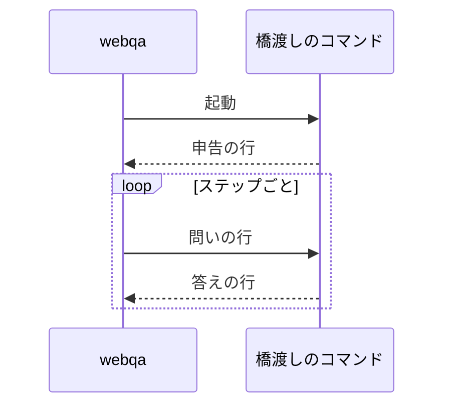

# 判断モデル

判断モデルは、画面の文と問いを受け取り、選択肢ごとの確率を返す。
中核の`webqa-core`は、問いと答えの型だけを知る。
どの判断モデルにつなぐかは、`webqa-judge`のアダプタが受け持つ。
全体の中での位置は[全体設計](overview.md)にある。

## 問いと答え

問いの種類は次の4つである。

| 種類 | 問いの形 | 答えの形 |
|---|---|---|
| `noul` | 真偽を問う | 選択肢`true`の確率 |
| `choice` | 選択肢から選ばせる | 選択肢ごとの確率 |
| `score` | 2から10個の点のどれかを付けさせる | 点ごとの確率 |
| `text` | 自由な文で答えさせる | 1つの文。確率は持たない |

答えの`Answers`は、問いごとの選択肢と確率の表と、トークンの使用量を持つ。
確率の無い選択肢は、確率をNaNとして持つ。

探索モードと決め打ちシナリオでは、1ステップの問いを1回の呼び出しでまとめて送る。

| 問い | 種類 | 中身 |
|---|---|---|
| `operation` | `choice` | 次の操作種別。選択肢は設定の`ops`から作る |
| `target` | `choice` | 操作する要素の番号。選択肢は画面の文の要素の数だけ作り、最大255個 |
| `error_shown` | `noul` | 画面にエラーの表示があるか |
| `goal_reached` | `noul` | 今の段階のゴールを達成したか。ゴールがあるときだけ問う |
| `confusing_display` | `noul` | 画面にわかりにくい表示があるか |

探索モードでは、`operation`の選択肢から`done`を外す。
また、`target`の選択肢を、候補の要素の番号だけに絞る。
候補の選び方は[探索モード](explore-mode.md)にある。
`confusing_display`は意味の判断が要る検出で、答えは参考情報の問題になる。
問題の記録は[問題の記録と実行結果](records.md)にある。
インタビューのモードは、共通の問いに足して、モードに固有の問いを問う。
足す問いは[インタビューのモード](interview-mode.md)にある。

画面の文は、表示領域の要素を番号を付けて並べたものである。
インタビューのモードだけ、その後ろに直近の操作の節が付く。
中身は[インタビューのモード](interview-mode.md)の「直近の操作」にある。

## 答えの検証

答えは中核の`read_answers`で検証する。
次のどれかに当たる答えは、使えない答えとして応答の異常になる。

- 問いの答えが無いか、選択肢が1つも無い。
- 問いに無い選択肢が返った。同じ選択肢が2回返ったときも、2回目を問いに無い選択肢とみなす。
- 確率が0以上1以下でない。

検証は、操作種別、要素、エラー表示、ゴールの順に行い、最初に見つけた誤りを返す。
探索モードでは、そのあとで選んだ要素が候補の番号に入っているかを確かめる。
候補の外の番号は、`target`の問いに無い選択肢(`NotAnOption`)として応答の異常にする。
対象の要らない操作種別では、要素の答えを読まない。
対象の要る操作種別は、clickとinputである。
要素が0件の画面でclickかinputが返ると、要素の答えが無いか問いに無い番号になる。
そのため、この答えも応答の異常になる。

選択肢は確率の高い順に並べ、確率の無い選択肢は最後に回す。
確率が同じなら、答えに書かれた順を保つ。
確信度は、選んだ操作種別の確率とする。
確率の無い答えは、低い確信度とみなす。

判断モデルの側の失敗も、応答の異常として中核へ渡す。
失敗の種類は次のとおり。

| 種類 | 意味 |
|---|---|
| `api` | 判断モデルのAPIがエラーを返した |
| `timeout` | 待ち時間内に答えが返らなかった |
| `malformed` | 答えの形式が読めない |
| `bridge` | 橋渡しのコマンドとやりとりできない |
| `exhausted` | 台本や記録の答えが尽きた |

応答の異常を受けた中核の振る舞いは[中核の状態機械](core.md)にある。

## 対象要素の選び方

要素は、`target`の答えを確率の高い順に並べ、先頭から選ぶ。
前のステップの後で画面が変わらなかったときは、前のステップの要素を避けて次の要素を選ぶ。
画面が変わらなければ、同じ番号は同じ要素を指すためである。
候補がその要素しか無ければ、その要素を選ぶ。

## Judgeのtrait

判断モデルは、`webqa-core`の`ports`にある`Judge`のtraitで表す。

```rust
pub trait Judge: Send {
    fn ask<'a>(
        &'a mut self,
        screen: &'a Redacted<ScreenText>,
        questions: &'a [Question],
    ) -> Pending<'a, Result<Answers, JudgeError>>;

    fn reads_images(&self) -> bool {
        false
    }

    fn ask_with_image<'a>(
        &'a mut self,
        screen: &'a Redacted<ScreenText>,
        image: &'a Image,
        questions: &'a [Question],
    ) -> Pending<'a, Result<Answers, JudgeError>> {
        let _ = image;
        self.ask(screen, questions)
    }
}
```

`Judge`は、`Box<dyn Judge>`として扱えるtrait1つにする。
接続先は設定で選ぶので、呼び出しは必ずオブジェクト越しになるためである。
`async fn`のメソッドは、オブジェクト越しに呼べない。
そこで、答えは`Pending`の型で返す。
`Pending`は`Pin<Box<dyn Future<Output = T> + Send + 'a>>`の別名である。

画面の文は`Redacted<ScreenText>`でしか受け取らない。
伏せ字を通していない画面は、型の上で判断モデルへ送れない。
伏せ字の仕組みは[安全のための仕組み](safety.md)にある。

`reads_images`は、判断モデルが起動のときに申告した、画像を読めるかである。
実行の途中では変わらない。
`ask_with_image`は、画面の文に画面のスクリーンショットを添えて問う。
画像を読めない判断モデルは、既定の実装で画像を捨て、画面の文だけで答える。
画像を添えて問うのは、インタビューのモードだけである。

## アダプタ

アダプタは次の3つである。

| アダプタ | 置き場所 | 使う場面 |
|---|---|---|
| 外部コマンドとの橋渡し(`CommandJudge`) | `webqa-judge`の`command` | 通常の実行 |
| 台本どおりに答えるスタブ(`Scripted`) | `webqa-judge`の`scripted` | テスト |
| 実行結果の再生(`Replay`) | `webqa`の`replay` | `webqa replay` |

通常の実行の接続先は、設定の`judge.kind`の名前で静的な表から選ぶ。
表の各行は、名前と、判断モデルを起動する関数の組である。
表には`command`の1行だけがある。
名前は大文字と小文字も含めて完全に一致させ、表に無い名前は設定エラーにする。
接続先を足すときは、表に1行足せば済み、`match`の腕は増えない。
スタブと再生は、台本が設定に無いので表に載せない。

起動の失敗は、終了コードで次のように分ける。

| 失敗 | 終了コード |
|---|---|
| `judge.kind`が表に無い | 2(設定エラー) |
| `judge.command`が無いか空 | 2(設定エラー) |
| コマンドを起動できない | 3(実行時エラー) |
| 申告の行が来ない、または読めない | 3(実行時エラー) |
| 申告の版が2でない | 3(実行時エラー) |

## 外部コマンドとの橋渡し

`CommandJudge`は、設定の`judge.command`を実行の開始時に1回だけ起動する。
配列の先頭がプログラムで、残りが引数である。
コマンドはシェルを通さずに直接起動する。
標準入力と標準出力をパイプでつなぎ、標準エラーは捨てる。
標準エラーには、画面の文字列や秘密が混ざりうるためである。
判断モデルを捨てるときは、コマンドも止める。

設定に`judge.api_key`があれば、その値を環境変数`WEBQA_JUDGE_API_KEY`で子プロセスに渡す。
`judge.api_key`が無ければ、`WEBQA_JUDGE_API_KEY`を子プロセスの環境から消して起動する。
そのときの認証は、外の仕組み(Network secretsのプロキシなど)に任せる。

### やりとりの形式

やりとりは、1行に1つのJSONを書いて改行で区切る。
どの行にも形式の版`version`を入れ、今の版は2である。



橋渡しは、起動の直後に申告の行を1行書く。

```json
{"version":2,"images":true}
```

`images`は、画像を読めるかの申告である。
版が2でなければ、起動の失敗にする。
`judge.timeout_secs`の間に読める申告の行が来なければ、これも起動の失敗にする。
知らない項目は無視する。

問いの行は次の形である。

```json
{"version":2,"seq":1,"screen":"1: button \"保存\"","image":{"media_type":"image/png","data":"<base64>"},"questions":[{"kind":"choice","id":"operation","prompt":"次に行う操作の種別を選ぶ","options":["click","back"]}]}
```

`screen`は、伏せ字を通した画面の文である。
`image`は、画像を読めると申告した橋渡しにだけ添える。
画像のバイト列は、改行を含まない標準のbase64で書く。
画像を添えない行には、`image`の項目を書かない。
`seq`は、問いの行を書くたびに1つ増える。

答えの行は次の形である。

```json
{"version":2,"seq":1,"answers":{"operation":[{"option":"click","p":0.9},{"option":"back","p":0.1}]},"usage":{"input_tokens":426,"output_tokens":100}}
```

失敗を返すときは、`answers`の代わりに`error`を書く。

```json
{"version":2,"seq":1,"error":{"kind":"api","message":"http 500"}}
```

`p`を省いた選択肢は、確率の無い選択肢になる。
`usage`を省けば、トークン数を0とみなす。
知らない項目は無視する。
`error`の`kind`は`api`か`timeout`にし、ほかの値は形式の誤りにする。
`message`は読まない。
次の行も形式の誤りにする。
JSONとして読めない行、版が2でない行、`error`も`answers`も無い行である。

答えの`seq`が今の問いより小さければ、前の問いへの遅れた答えとして読み飛ばす。
前の問いが待ち時間を過ぎたあとに、その答えが届くことがあるためである。
答えの`seq`が今の問いより大きければ、形式の誤りにする。
問いの行を書いてから`judge.timeout_secs`の間に答えが来なければ、`timeout`にする。
コマンドが終わって出力が閉じたら、`bridge`の失敗にする。
待ち時間は、注入した時計で測る(時計は[ランタイム](runtime.md)にある)。

### JEVへの橋渡し

`bridge/jev.py`は、JEVの判断モデルへの橋渡しである。
Pythonの標準ライブラリだけで書き、Vercel AI Gatewayへ送る。
JEVは、`noul`、`choice`、`score`の問いだけに答える。
そこで、`text`の問いは同じGatewayの言語モデルへ送る。
JEVの問いは1回の呼び出しにまとめ、`text`の問いは1つずつ別の呼び出しにする。
インタビューのモードは、期待(`expectation`)の問いだけを別の行で送る([インタビューのモード](interview-mode.md))。
その行にはJEVの問いが無いので、JEVを呼ばず、言語モデルへの1回の呼び出しだけで答える。
時間の予算は行ごとに測るので、1つのステップの2行は、それぞれ`--timeout`まで待つ。
`text`の問いには、systemのメッセージで次の決まりを伝える。
答えだけを返す。Markdown、見出し、前置き、独白を書かない。
問いが求める形(1文、「番号: 理由」の行の並び)を守る。
空の文字列を返してよいのは、見えにくい要素(`hard_to_see`)の問いだけにする。
その問いには、半角の「番号: 理由」の行だけを書き、記号や前置きを付けないことも伝える。
ほかの自由な文の問いには、必ず1文を返させる。
それでも崩れたときの守りは、受け取った文の前後の空白を取ることだけにする。
中身は作り変えない。
見えにくい要素(`hard_to_see`)の問いは、行に画像があれば、画面の文と並べて画像も送る。
画像は、chat completionsの`image_url`にdata URLで入れる。
画像を扱えない言語モデルを`--text-model`に選ぶと、その問いはGatewayの失敗(`api`)になりうる。
Gatewayへの送信、時間の予算、送り直し、リダイレクトの扱いは`bridge/gateway.py`にまとめてある。

引数は次の3つである。

| 引数 | 既定 | 中身 |
|---|---|---|
| `--model` | `typesafe-ai/jev-1.14.0` | JEVのモデル |
| `--text-model` | 無し | `text`の問いを送る言語モデル |
| `--timeout` | 30 | 問いの1行あたりの時間の予算(秒) |

`--text-model`を書かなければ、`text`の問いを含む行には`api`の失敗を返す。
`--timeout`は、0より大きく3600以下の秒数にする。
外れた値では、橋渡しは引数の誤りで終わる。
申告の行が来ないので、webqaは起動の失敗(終了コード3)で止まる。

予算は、問いの行を読んだ時刻から数える。
`text`の問いと送り直しの待ちも、同じ予算に収める。
予算を使い切ると、`timeout`の失敗を返す。
1回のHTTPの待ちの上限は、その時点の残りの時間である。
応答の本体を細切れに送られると、予算を超えることがある。
そのときは、webqaの側の`judge.timeout_secs`が打ち切る。
そのため、`--timeout`は`judge.timeout_secs`より短くする。

`--model`が`typesafe-ai/jev-1.13.0`か`typesafe-ai/jev-1.14.0`のときだけ、画像を読めると申告する。
JEVへの問いに画像を添えるときは、画像を許すヘッダを要求に付ける。
ヘッダは`TypeSafe-Danger-Zone-Images: true`である。
言語モデルへの自由文の問いには付けない。

APIキーは、環境変数`WEBQA_JUDGE_API_KEY`から読む。
値があれば`Authorization`のヘッダに載せ、無ければ認証のヘッダを付けない。
リダイレクトは追わず、3xxの応答は失敗として返す。
キーが別のホストへ渡らないようにするためである。
Gatewayが混んでいる(429か529)ときは、最大2回まで送り直す。
送り直す前の待ちは`Retry-After`に従い、最大5秒とする。
残りの予算に収まらない待ちになるときは、送り直さない。
失敗の文には秘密を含めない。
問いに答えている間は、標準エラーに何も書かない。
標準エラーに書くのは、引数の誤りでargparseが使い方を示すときだけである。

## 実行結果の再生

`webqa replay`では、判断モデルの代わりに`Replay`を使う。
`Replay`は、`report.json`の`calls`に記録した答えと失敗を、記録の順に返す。
問いの中身は記録と照らし合わせない。
再生も同じ設定で、通常と同じ実行ループとガードレールを通るので、問いは記録と同じ順に来る。
記録が尽きたら、`exhausted`の失敗を返す。
`Replay`は、画像を読めると申告しない。
コマンドの使い方は[コマンド](cli.md)にある。
実行結果の形は[問題の記録と実行結果](records.md)にある。

## 台本どおりに答えるスタブ

`Scripted`は、問いの名前ごとに台本の答えを順に返すスタブで、テストで使う。
問いのどれかに台本の答えが残っていなければ、`exhausted`の失敗を返す。
画像を読めると申告させることもできるが、画像そのものは見ない。
テストでの使い方は[テスト](testing.md)にある。
