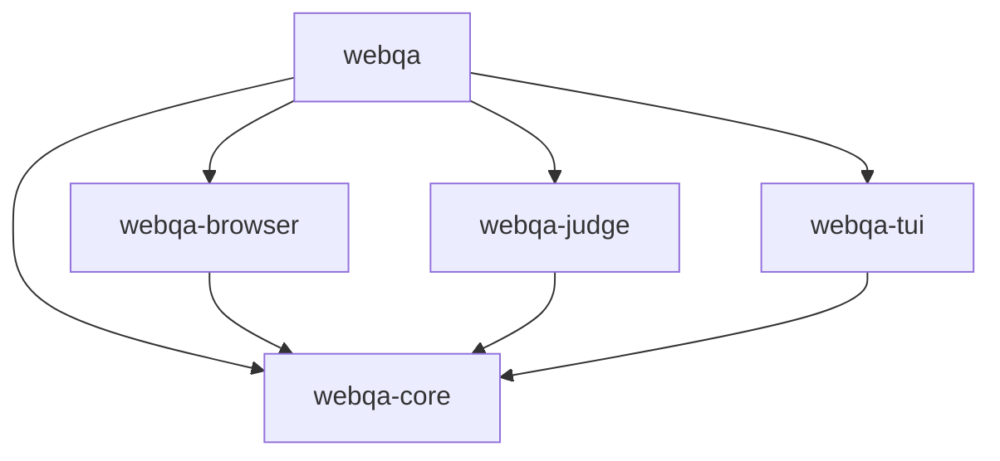

# 全体設計

webqaは、Webサービスの探索的テストエージェントである。
判断モデルに画面のアクセシビリティ情報を渡し、返ってきた操作をブラウザで実行する。
これを繰り返して画面を探索し、不具合や表示の違和感を記録する。
この文書は、全体の構成とcrateの分け方、3つのモードの位置づけをまとめる。

## 方針

設計は次の4つの方針に従う。

1. 判断と状態遷移は、副作用を持たない純粋な中核に集める。
2. ブラウザ、判断モデル、ファイル、時計は、中核の外の薄いアダプタに置く。
3. 中核の状態遷移は、TLA+の仕様のアクションから対応表でたどれるようにする。
4. 機能はすべてCLIで満たし、実行を見るTUI(`watch`の画面)は、イベントログを読んで表示するだけにする。

品質ゲートは関数ごとに厳しい。
そのため、分岐の多い処理は中核の小さな関数に分け、表やtraitで場合分けする。
書き方は[code-style.md](code-style.md)にまとめた。

## 全体の構成とデータの流れ

全体の構成の図は`.omm/`にあり、`just omm view`で開ける。

CLIの`webqa`は、YAMLの設定を読み、実行ループを回す。
実行ループは、ブラウザで画面を観測し、その観測を中核の`webqa-core`に渡す。
中核は次にすることを1つの効果として返す。
効果は、判断モデルへの問い合わせ、ブラウザの操作や観測、待機のどれかである。
実行ループは効果を実行し、その結果を次の入力として中核に返す。
中核の状態遷移は[core.md](core.md)に書いた。

ブラウザの操作は`webqa-browser`が受け持ち、Playwright経由でChromiumを動かす。
判断モデルへの問い合わせは`webqa-judge`が受け持つ。
`webqa-judge`は外部コマンドを起動し、その橋渡しのコマンドが判断モデルへ送る。
橋渡しは[judge.md](judge.md)に書いた。

実行ループは、探索の記憶、イベントログ、実行結果を`.webqa/`に書く。
TUIの画面は2つある。
`watch`の画面は、`webqa watch`で別のプロセスとして動き、イベントログを読んで表示する。
台帳の画面は、`webqa ledger`でインタビューの台帳を開き、選んだ課題を台帳に書き戻す。
どちらの画面も実行の状態は変えない。
記録の形は[records.md](records.md)にある。

## crateの分け方

crateは次の5つに分ける。

| crate | 種類 | 受け持つもの |
|---|---|---|
| `webqa-core` | lib | 状態機械、ガードレール、探索の記憶、段階とdone_when、問題の検出、時間窓、伏せ字、設定の型と検証、イベントの型、ポートのtrait、インタビューのモードの純粋な部品 |
| `webqa-browser` | lib | playwright-rsのアダプタ。アクセシビリティ情報の取得、操作、コンソール、スクリーンショット |
| `webqa-judge` | lib | 判断モデルのアダプタ。台本どおりに答えるスタブと、外部コマンドとの橋渡し |
| `webqa-tui` | lib | `watch`の画面(イベントログの追跡と表示)、インタビューの台帳の画面、台帳の画面のキーと端末 |
| `webqa` | lib、bin | CLI、実行ループ、時計、記録の保存、中断の処理、インタビューの試行のループ |

crateの依存の向きは次のとおり。
矢印の先が依存される側である。



`webqa-core`は、ワークスペースの中のほかのcrateに依存しない。
playwright-rs、tokio、ratatuiも`webqa-core`に入れない。
中核は同期のコードだけで書き、時刻は引数で受け取る。
そのため、中核のテストは待たずに決定的に回る。

`webqa`は、libとbinの2つのターゲットを持つ。
受け入れのテストと保存のテストは、libを通して実行ループと保存を使う。
配布する実行ファイルは`webqa`の1つだけで、TUIもサブコマンドで起動する。
各crateが使う外部crateは[dependencies.md](dependencies.md)にある。

## 3つのモード

探索モード(`webqa explore`)は、対象のサイトを手順なしで探索する。
判断モデルが画面を見て操作を選び、中核は未操作の要素を優先して候補を絞る。
禁止要素を除くすべての要素を探索し終えたら、ゴール達成で終わる。
詳しくは[explore-mode.md](explore-mode.md)にある。

決め打ちシナリオモード(`webqa run`)は、設定に書いた段階を順にたどる。
各段階のゴールはdone_whenで書き、満たしたら次の段階へ進む。
最後の段階のdone_whenを満たしたら、ゴール達成で終わる。
詳しくは[scenario-mode.md](scenario-mode.md)にある。

インタビューのモード(`webqa interview`)は、ペルソナを持たせた判断モデルに画面を触らせる。
1回の実行で、1つの目的を何回か試す。
各試行は、目的を1つの段階にした決め打ちシナリオとして中核を回す。
迷うところ、見えにくいところ、目的にたどり着かないところを、直す指示の台帳としてMarkdownに出す。
詳しくは[interview-mode.md](interview-mode.md)にある。

3つのモードは、同じ中核の状態機械と同じガードレールを通る。
ガードレールと負荷制御は[safety.md](safety.md)に書いた。

## ディレクトリ構成

```text
crates/
  webqa-core/        中核(同期の純粋なコード)
    src/
      machine/       状態、遷移の表、カウンタ
      plan.rs        待機中の優先順位
      stage.rs       段階とdone_when
      guard/         ガードレールの判定
      explore/       探索の記憶のグラフと候補の絞り込み
      judge/         問いの組み立てと応答の検証
      interview/     問い、課題、台帳、照らし合わせ
      config/        設定の型と検証
      redact/        伏せ字
      issue/         問題の種類と検出
      window/        時間窓
      event/         イベントログの型
      screen/        画面と要素の識別、画面の変化
      ports.rs       ブラウザ、判断モデル、時計、保存先のtrait
    tests/           全状態の探索、ゴールデンテスト
  webqa-browser/     playwright-rsのアダプタ
  webqa-judge/       判断モデルのアダプタ
  webqa-tui/         watchの画面と台帳の画面
    src/
      ledger/        台帳の画面の状態と描画
      keys.rs        台帳の画面のキーと、本物の端末
  webqa/             CLI
    src/
      cli/           サブコマンドと起動
      run/           実行ループと効果の実行
      setup/         設定から実行に要るものを組み立てる
      record/        実行結果に残す判断、操作、問題
      replay/        実行結果の答えを返す判断モデル
      watch/         イベントログの追跡と表示
      ledger.rs      台帳の画面を開き、キーと書き戻しをつなぐ
      interview/     試行のループと初期化のコマンド
      store/         記憶、イベントログ、実行結果の保存
    tests/           受け入れ、契約、実行ファイルのテスト
bridge/              判断モデルへの橋渡しのコマンド(Python)
share/skills/        配布する手引き(ペルソナと目的の書き方)
scripts/             セットアップと品質ゲートの補助
docs/                文書
.omm/                アーキテクチャの図(oh-my-mermaid)
skills/              開発の作業の手順書
agents/              Claude Code向けのサブエージェント
tasks/               設計検討の記録
```

実行時の出力は、作業ディレクトリの`.webqa/`に置く。
置き場所はCLIの引数`--out`で変える。

## docs/archの文書

| 文書 | 中身 |
|---|---|
| [overview.md](overview.md) | 全体設計(この文書) |
| [core.md](core.md) | 中核の状態機械 |
| [code-style.md](code-style.md) | 品質ゲートの下での書き方 |
| [explore-mode.md](explore-mode.md) | 探索モード |
| [scenario-mode.md](scenario-mode.md) | 決め打ちシナリオモード |
| [interview-mode.md](interview-mode.md) | インタビューのモード |
| [safety.md](safety.md) | ガードレール、負荷制御と判断予算、機密情報の扱い |
| [judge.md](judge.md) | 判断モデルの抽象、アダプタ、橋渡し、再実行 |
| [config.md](config.md) | 設定ファイル |
| [cli.md](cli.md) | コマンドの体系、引数、終了コード |
| [records.md](records.md) | 問題の記録、実行結果、イベントログ、TUI |
| [runtime.md](runtime.md) | 非同期ランタイム、エラー、ログ、時計、中断 |
| [testing.md](testing.md) | テストの層 |
| [dependencies.md](dependencies.md) | 使っている依存 |
