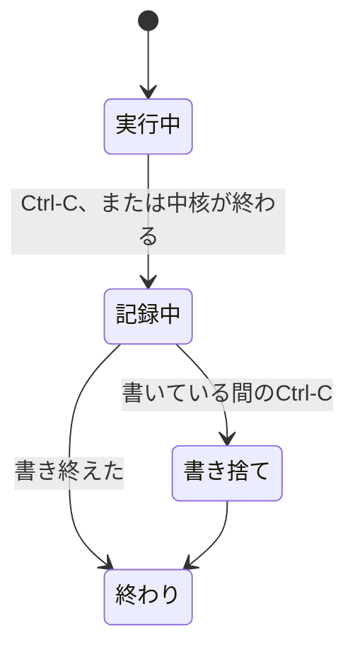

# ランタイム

非同期ランタイム、エラー、ログ、時計、中断は、`webqa`のCLIが中核の外で受け持つ。
中核の`webqa-core`は同期のコードだけで書き、tokioにもtracingにも依存しない。
時計の`Clock`のtraitは中核の`ports`に置き、本物の時計はCLIが渡す。

## 非同期ランタイム

非同期ランタイムはtokioにする。
playwright-rsがtokioに依存しているので、ほかを選ぶ余地は無い。
`main`は、スレッドが1本の`current_thread`のランタイムを自分で作る。
ランタイムを作れなければ、終了コード3で終わる。

実行ループは1つのタスクで順に進め、タスクを別に起こさない。
並行にするのは、中断の受け取りだけである。
実行ループは、効果の実行と中断の待ちを`select!`で並べる。
ブラウザのコンソールのエラーは、Playwrightのコールバックで集めておき、次の観測で取り出す。

`webqa-core`は非同期ランタイムに依存せず、時刻は引数で受け取って自分では読まない。
そのため、中核のテストは待たずに決定的に回る。
中核の作りは[中核の状態機械](core.md)にある。

## エラー

エラーは、crateごとにthiserrorの列挙型で書く。
エラーの値には、画面の文字列も秘密の値も持たせない。

実行の途中の失敗は、種類によって扱いを分ける。

| 失敗 | 扱い |
|---|---|
| ブラウザの待ち時間切れ | エラーにせず、画面が変化しなかった観測として中核へ渡す |
| 判断モデルの失敗 | 応答の異常として中核へ渡す |
| 設定エラー | 起動の前に止め、終了コード2で終わる |
| ブラウザの起動の失敗 | 実行を止め、終了コード3で終わる。インタビューのモードで試行のブラウザを開けなかったときは、それまでの試行で台帳と記録を終了理由`error`で書いてから終わる |
| ブラウザの操作の失敗 | 実行を止め、そこまでの記録を終了理由`error`で書いてから、終了コード3で終わる |
| 記録の書き込みの失敗 | 実行を止め、終了コード3で終わる |

応答の異常の中身は[判断モデル](judge.md)、終了コードは[コマンド](cli.md)にある。

設定エラーなど人に見せる文は、標準エラーのハンドルに`writeln!`で書く。
clippyの`print_stdout`と`print_stderr`は、`println!`と`eprintln!`を止める。
そのため、これらのマクロは使わない。

## ログ

診断用のログは、tracingで標準エラーへ出す。
水準は環境変数`WEBQA_LOG`で変え、書かなければ`warn`にする。
`WEBQA_LOG`は、tracing-subscriberの`EnvFilter`の書き方で読む。
`playwright_rs`のログは、`WEBQA_LOG`の値によらず`info`までに抑える。
`playwright_rs`の`trace`の水準には、入力欄に打った値が載るためである。

`tracing`のログには、画面の文言を載せない。
実行の記録はイベントログが受け持ち、`tracing`のログは記録として扱わない。
イベントログは[問題の記録と実行結果](records.md)にある。

## 時計

時計は、`webqa-core`の`ports`にある`Clock`のtraitで表す。

```rust
pub trait Clock: Send {
    fn elapsed(&self) -> Duration;
    fn sleep_until(&mut self, at: Duration) -> Pending<'_, ()>;
}
```

`elapsed`は、時計を動かし始めてからの時間を返す。
`sleep_until`は、動かし始めてから`at`の時間が経つまで待つ。
表せないほど先の時刻を渡すと、待ちは終わらない。

本物の時計`RealClock`は、`webqa`の`clock.rs`にだけ置く。
時刻を読むメソッドと待つメソッドは、clippyの`disallowed-methods`で禁止する。
`clock.rs`の3か所だけ、理由を書いた`#[expect]`の注釈で許す。
こうすると、時刻を読む経路は`clock.rs`の1つだけになる。

禁止するメソッドは次のとおり。

- `std::time::Instant::now`、`std::time::SystemTime::now`
- `std::thread::sleep`
- `tokio::time::Instant::now`
- `tokio::time::sleep`、`tokio::time::sleep_until`、`tokio::time::timeout`
- `jiff::Timestamp::now`、`jiff::Zoned::now`

待ち時間の打ち切りも、`tokio::time::timeout`を使わず`Clock`の待ちで書く。
テストは偽の時計を注入するので、本物の時間を待たずに回る([テスト](testing.md))。

実行は2つの時計を使う。
判断モデルの橋渡しの時計は、判断モデルを起動する前に動かし始める。
実行ループの時計は、ブラウザが起動したあとで動かし始める。
イベントログの経過時間は、実行ループの時計で測る。

壁時計は、実行ループの時計を動かし始める直前に1回だけ読む。
読んだ時刻から、開始の時刻と実行IDの2つの文字列を作る。
開始の時刻はUTCの秒までで、`YYYY-MM-DDThh:mm:ssZ`の形にする。
開始の時刻は、イベントログの1行目と実行結果に書く。
実行IDはUTCのミリ秒までで、`YYYYMMDDThhmmss.SSSZ`の形にする。
実行IDは、実行のディレクトリの名前に使う。

## 中断

中断は、`webqa`の`interrupt`にある`Interrupt`のtraitで受け取る。
本物の実装`CtrlC`は、tokioでCtrl-Cを待つ。
Ctrl-Cの受け取りを登録できなかったときも、中断として扱う。
待ち続けると、利用者が実行を止める手段が無くなるためである。

中断は状態機械の外から来るので、中核の遷移の表には入れない。
実行ループが中断を受け取り、終了理由を決めて記録を書く。



実行ループは、効果を1つ実行するたびに、その実行と中断の待ちを並べる。
Ctrl-Cを受けたら、今の効果の待ちを打ち切る。
終了理由は利用者による中断(`user_aborted`)にする。
そのあと、探索の記憶、終了のイベント、実行結果を書いてから終わる。
再実行では、探索の記憶を書かない。

記録を書いている間のCtrl-Cは、終わり方によって扱いを変える。
中断で終わった実行では、書いている間に次のCtrl-Cを受けたら、書き終わりを待たずに終わる。
中断以外の理由で終わった実行では、書いている間の1回目のCtrl-Cを受け流し、2回目で書き終わりを待たずに終わる。
書き終わりを待たずに終わるときは、書く処理を捨てる。
そのあと、ランタイムを`shutdown_background`で止めて`main`から戻る。
標準エラーには`記録を書き終える前に中断した`と書き、終了コード3で終わる。
`std::process::exit`は使わない。

判断モデルとブラウザの起動中など、実行ループが最初に中断を待つより前のCtrl-Cは、OSの既定の振る舞いになる。
このときは記録を残さずに終わる。
終了コードは[コマンド](cli.md)の表のどれでもなく、シグナルによる終了になる。

playwright-rsは、自前のCtrl-Cの処理を持ち、記録を書く前に終了コード130で抜ける。
そこで、`cli::entry`は環境変数`PLAYWRIGHT_NO_SIGNAL_HANDLER`を立てて、その処理を止める。
playwright-rsは、この変数をブラウザの起動のときに読む。
環境変数を変えるのは、ログを始めてランタイムを作る前の、スレッドが1本のうちに限る。
この操作は`dotenvy`に任せる。
workspaceの`Cargo.toml`で`unsafe_code`を`forbid`にし、どのcrateでも`unsafe`のコードを禁じているためである。
`.env`などで値がすでにあれば、そちらが勝つ。

インタビューのモードの中断は、試行の終わり方`interrupted`になる。
中身は[インタビューのモード](interview-mode.md)にある。
`webqa watch`は、Ctrl-Cを受けたら終了コード0で終わる([問題の記録と実行結果](records.md))。
