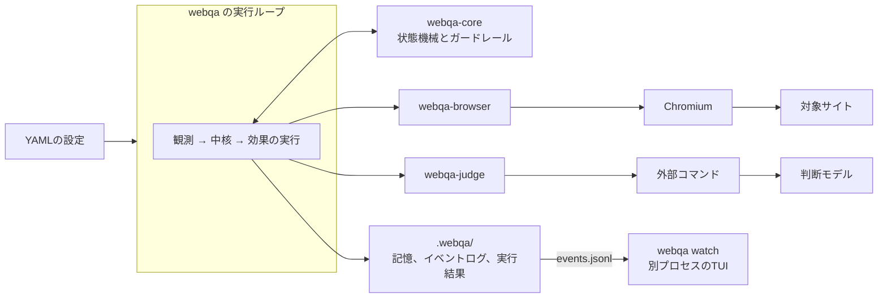
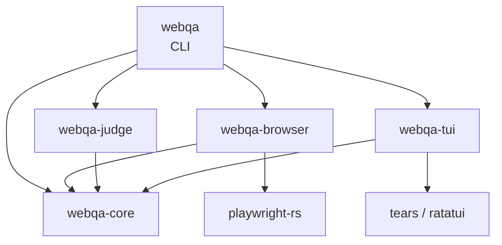
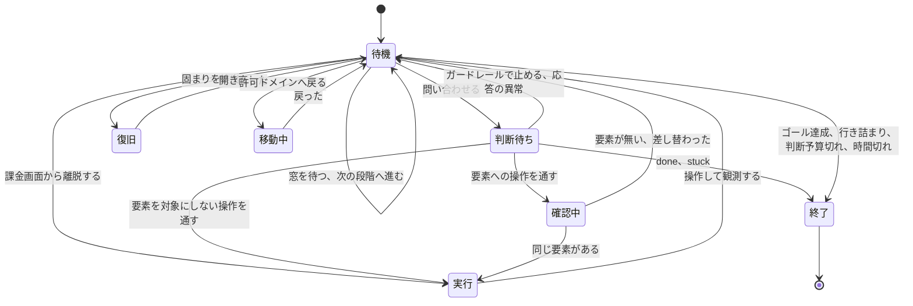

# アーキテクチャ(草案)

この文書は、実装に入る前のアーキテクチャとディレクトリ構造の草案である。
設計の承認者が決めた論点は、本文に反映した。
要件を変えたところと足したところは「要件の変更と追加」の節にまとめた。
実装の最初に確かめることと決めることは、末尾の2つの節に置いた。
要件の一次情報は`tasks/loopeng/`の記録にある。
読み方は[`docs/design-records.md`](design-records.md)を見てほしい。

本文の3つの図は、草案のうちは`mermaid`のコードブロックで本文に置く。
実装が入ったら、oh-my-mermaidで`.omm/`へ移す。

## 方針

設計は次の4つの方針に従う。

1. 判断と状態遷移は、副作用を持たない純粋な中核に集める。
2. ブラウザ、判断モデル、ファイル、時計は、中核の外の薄いアダプタに置く。
3. 中核の状態遷移は、TLA+の仕様のアクションから対応表で辿れるようにする。
   受け入れ条件に合わせてずらしたところは、対応表に書く。
4. 機能はすべてCLIで満たし、TUIはイベントログを読んで表示するだけにする。

品質ゲートは関数ごとに厳しい。
そのため、分岐の多い処理は中核の小さな関数に分け、表やtraitで場合分けする。
具体的な書き方は「複雑度の上限に耐える書き方」の節にまとめた。

## 全体の構成

データは次のように流れる。



crateの依存の向きは次のとおり。
矢印の先が依存される側である。



`webqa-core`は、ワークスペースの中のほかのcrateに依存しない。
playwright-rs、tokio、ratatuiは`webqa-core`に入れない。
crateを分けておけば、アダプタの型を中核のコードから誤って使うことはできない。
ただし、`webqa-core`の`Cargo.toml`にtokioを足すこと自体は止められない。
機械で止めるなら、cargo-denyの`bans`で縛る。
tokioなどに依存してよい親のcrateを、`wrappers`に並べる。

## crateの分け方

crateは次の5つに分ける。

| crate | 種類 | 受け持つもの | 主な依存 |
|---|---|---|---|
| `webqa-core` | lib | 状態機械、待機中の優先順位、ガードレール、探索の記憶のグラフと候補の絞り込み、段階とdone_when、問題の検出、時間窓、伏せ字、設定の型と検証、イベントの型、ポートのtrait | serde、serde-saphyr、url、regex、thiserror |
| `webqa-browser` | lib | playwright-rsのアダプタ。アクセシビリティ情報の取得、操作、URL、コンソール、スクリーンショット | webqa-core、playwright-rs、tokio |
| `webqa-judge` | lib | 判断モデルのアダプタ。台本どおりに答えるスタブと、外部コマンドとの橋渡し | webqa-core、serde_json、tokio |
| `webqa-tui` | lib | イベントログの追跡と表示 | webqa-core、tears、ratatui、crossterm、tokio |
| `webqa` | bin | CLI、実行ループ、時計、記憶・ログ・結果の保存、中断の処理 | 上の全部、clap、tokio、tracing、jiff |

今ある空の`crates/webqa`は、製品名と同じ名前なのでCLIのcrateとして使う。
TUIは`webqa watch`というサブコマンドで起動し、配布する実行ファイルを1つにする。
TUIのコードは`webqa-tui`に分け、CLIの実行ループとは別のプロセスで動かす。

`webqa-core`は同期のコードだけで書き、非同期ランタイムに依存しない。
時刻は引数で受け取り、自分では読まない。
そのため、中核のテストは待たずに決定的に回る。

## 中核の状態機械

### 状態の持ち方

仕様の変数は、次のように実装へ写す。
残りの予算は持たず、使った数と上限から導く。
こうすると、残りと使った数の和が上限に等しいことは型の作りで保たれる。

| 仕様の変数 | 実装での置き場所 |
|---|---|
| `phase` | `State::phase`(待機、判断待ち、確認中、実行、移動中、復旧、終了) |
| `proposedOp`、`proposedTarget`、`proposedLowConf` | 判断待ちから実行までの間だけ持つ`Proposal` |
| `isPaywall`、`targetExists`、`screenChanged` | 状態に持たず、観測値から中核がその都度判定する |
| `visited` | 探索の記憶`Memory`(画面ごとのグラフ) |
| `idleCounter`、`stuckCounter` | `State`のカウンタ |
| `inAllowedDomain` | `State`の「許可ドメインの外にいる」の記録 |
| `pageOutside` | 持たない(仕様の検査のためだけの変数) |
| `decisionBudget`、`decisionsMade` | `Budget { used, cap }` |
| `requestBudget`、`requestsInWindow` | `RequestWindow { index, used, cap }` |
| `exitReason` | 終了の段に持つ`ExitReason` |

仕様に無い状態として、次のものを持つ。

- 直前の観測`Screen`。
  画面が変化したかは、次の観測とこれを比べて判定する。
- 直前に操作した要素と、そのとき画面が変化したか。
  同じ要素を続けて選んだら次の候補へ切り替える判定に使う。
- 今の画面で表示領域に現れたことのある要素の集合。
  未操作の要素が新しく見えたかの判定に使う。
- 今の段階の番号と、実行の開始からの経過時間の上限。

### 状態遷移の概略



ツールの利用者による中断は、この状態機械の外から実行ループが受け取る。
扱いは「中断」の節に書いた。

### アクションの表

仕様の各アクションは、ガードと遷移の組として静的な表の1行に書く。
1行は、有効になる条件の関数と、遷移の関数の2つを持つ。

```rust
pub(crate) struct Action {
    pub(crate) name: &'static str,
    pub(crate) enabled: fn(&State, &Facts) -> bool,
    pub(crate) fire: fn(State, &Facts) -> Next,
}

/// 実行ループへ返すもの。
pub enum Step {
    Continue(State, Effect),
    Finished(Outcome),
}

/// 1行の遷移の結果。中核の中だけで使う。
enum Next {
    Go(State),
    Out(Step),
}
```

表には、外に効果を頼まない行も多い。
段階を進める行、止める行、応答の異常の行がそうである。
確認中の中止の行と、観測を受ける行も同じである。
これらの行は`Next::Go`を返し、中核の中で同じ`Facts`のまま次の行を調べる。
`core::step`は、`Next::Out`が出るまで行を続けて調べ、出た`Step`を返す。
`Action`は非公開の`Next`を返すので、`Action`も`pub(crate)`にする。
公開すると、rustcの`private_interfaces`の警告が`-D warnings`で失敗になる。
`core::step`は2つの関数に分ける。
1つは表から最初に有効な行を選んで実行する関数である。
もう1つは、結果が`Go`なら自分を呼び直し、`Out`なら返す関数である。
こう分けると、どちらの関数も複雑度の上限に収まる。
そのため、実行ループが受け取る`Step::Continue`は必ず効果を持つ。
何もしない効果は要らない。
`Next::Go`を返す行は、必ず`phase`か段階の番号を進める。
そのため、続けて調べる回数には上限がある。
上限は全状態の探索のテストで確かめる。

待機中の優先順位は、表の行の順番で表す。
上から順にガードを調べ、最初に有効になった行だけを使う。
仕様と同じく、各行のガードは上位の条件が成り立たないことも確かめる。
上位の条件の否定は、名前の付いた小さな述語にする。
名前は「探索中」「続行できる」のように付ける。
1つのガードには述語を2つまで並べ、それ以上は述語を重ねて作る。
こうすると、段をまたいで行の順番を入れ替えても、採る行は変わらない。
ガードの関数も複雑度の上限に収まる。

| 段 | 待機中に採る行 | 外に頼む効果 |
|---|---|---|
| 1 | ゴールを満たした → 次の段階へ進むか、ゴール達成で終了 | なし |
| 2 | 行き詰まりを検出 → 行き詰まりで終了 | なし |
| 3 | 判断予算切れ → 判断予算切れで終了 | なし |
| 3 | 制限時間に達した → 時間切れで終了 | なし |
| 4 | 時間窓の上限に達している → 窓が明けるまで待つ | 待機 |
| 4 | 固まりを検出 → ページを開き直す | 再読み込み |
| 4 | 許可ドメインの外 → 移動中へ | 許可ドメインへの移動 |
| 4 | 課金画面 → 既定の離脱操作を提案にして実行へ | 離脱のブラウザ操作 |
| 5 | 判断モデルに問い合わせる | 問い合わせ |

1段目のゴールは、モードで変わる。

- 決め打ちシナリオでは、今の段階のdone_whenを満たしたこと。
  最後の段階ならゴール達成で終了し、そうでなければ次の段階へ進む。
- 探索モードでは、禁止要素を除くすべての要素を探索し終えたこと。
  満たしたらゴール達成で終了する。

4段目では、時間窓を待つ行を最初に採る。
上限に達している間は、再読み込み、戻り、離脱も窓が明けるまで待つためである。
固まり、ドメインの外、課金画面の3行のガードは、時間窓の空きも確かめる。
この3行の間の順番は受け入れ条件で決めておらず、テストの期待値にしない。
3段目の2行の間の順番も同じ扱いにする。

判断待ち以降の行は次のとおり。

| 起点 | 行 | 外に頼む効果 |
|---|---|---|
| 判断待ち | 応答の異常 → 記録して待機へ戻る | なし |
| 判断待ち | 禁止要素、低確信度の「戻る」 → 止めて待機へ戻る | なし |
| 判断待ち | done → 未検証の終了 | なし |
| 判断待ち | stuck → 行き詰まりで終了 | なし |
| 判断待ち | 要素への操作を通す → 確認中へ | 実行直前の要素の取り直し |
| 判断待ち | 要素を対象にしない操作を通す → 実行へ | ブラウザ操作 |
| 確認中 | 要素が無い、または差し替わった → 中止して待機へ戻る | なし |
| 確認中 | 同じ要素がある → 実行へ | ブラウザ操作 |
| 実行 | 操作や離脱のあとの観測を受け、カウンタを更新する → 待機へ戻る | なし |
| 移動中 | 戻ったあとの観測を受ける → 待機へ戻る | なし |
| 復旧 | 開き直したあとの観測を受ける → 待機へ戻る | なし |

観測を受ける3行は、観測を状態に入れてから待機へ戻る。
実行の行では、その前にカウンタも更新する。
待機へ戻ったあとは、同じ`Facts`のまま優先順位を上から調べる。
待機の行が読む画面は、状態に入れた直前の観測である。
`Facts`から使うのは時刻だけである。
離脱のあとで行き詰まりの回数が閾値に届くことがある。
そのときは、同じ`core::step`の中で行き詰まりとして終わる。

ガードレールの「要素の存在と同一性」は、確認中の2行で効く。
そのほかのガードレールは、判断待ちの行で効く。
課金画面だけは、問い合わせの前に待機の4段目で効く。

### カウンタの更新

カウンタは、実行で観測を受ける行でだけ変える。
課金画面からの離脱も、既定の離脱操作を提案にして実行の段を通る。
そのため、離脱もこの行で数える。

| 観測の結果 | 固まりの回数 | 行き詰まりの回数 |
|---|---|---|
| 画面が変化しなかった | 1増やす | 下の2行に当たらなければ1増やす |
| 画面が変化した | 0に戻す | 下の2行に当たらなければ1増やす |
| 未操作の要素を操作した | 上の2行による | 0に戻す |
| スクロールで未操作の要素が新しく見えた | 上の2行による | 0に戻す |

課金画面からの離脱は「戻る」と同じく操作済みの要素を増やさない。
そのため、離脱のたびに行き詰まりの回数が1増える。
消えない課金画面が続けば、閾値の回数で行き詰まりとして終わる。

開き直したあとは固まりの回数を0に戻し、行き詰まりの回数は変えない。
段階を進めたら、固まりと行き詰まりの回数をどちらも0に戻す。
ガードレールで止めた提案、応答の異常、確認中の中止では、どちらの回数も変えない。
この3つでも判断予算は1回使う。

### 1ステップの流れ

実行ループは、中核が返す効果を実行し、その結果を次の`Facts`にして中核へ返す。

```rust
async fn run(start: Step, ports: &mut Ports<'_>) -> Result<Outcome, RunError> {
    let mut step = start;
    while let Step::Continue(state, effect) = step {
        step = advance(state, effect, ports).await?;
    }
    step.into_outcome()
}

async fn advance(state: State, effect: Effect, ports: &mut Ports<'_>) -> Result<Step, RunError> {
    let facts = ports.perform(effect).await?;
    Ok(core::step(state, &facts))
}
```

`perform`は効果を実行し、結果を`Facts`にして返す。
`Facts`は時刻のほかに、効果ごとに次のどれかを持つ。

| 効果 | `Facts`に入るもの | 受ける行 |
|---|---|---|
| 問い合わせ | 判断モデルの答えか、応答の異常 | 判断待ち |
| 実行直前の要素の取り直し | 取り直した要素の一覧 | 確認中 |
| ブラウザ操作、離脱 | 操作のあとの観測`Screen` | 実行 |
| 許可ドメインへの移動 | 移動のあとの観測`Screen` | 移動中 |
| 再読み込み | 開き直したあとの観測`Screen` | 復旧 |
| 待機 | 目覚めた時刻だけ | 待機 |

観測`Screen`は、次のものを持つ。

- 表示領域の中の操作可能要素の一覧
- ページ全体の要素の一覧(見出しなど操作できない要素も含む)
- ページ全体のテキスト
- URL、コンソールのエラー、課金画面の材料

done_whenの`element`と`text`は、ページ全体の要素の一覧とテキストで判定する。
中核は、直前の観測と比べて画面が変わったかを判定する。
判定の材料を集めるのはアダプタで、判定するのは中核である。

### 効果の振り分け

効果は約8種類あるが、`perform`で8本の腕の`match`は書けない。
そこで、効果を腕2本ずつの入れ子の列挙型にする。

```rust
pub enum Effect { Outside(Outside), Page(PageEffect) }
pub enum Outside { Ask(Questions), Sleep(Wake) }
pub enum PageEffect { Look(Target), Touch(Touch) }
```

`Touch`は、ブラウザ操作、離脱、再読み込み、移動をまとめた構造体にする。
どのPlaywrightの呼び出しにするかは、`webqa-browser`の中の静的な表で引く。
表の各行は、操作の名前と、`Pin<Box<dyn Future + Send>>`を返す関数の組である。
`perform`は入れ子の各段で腕2本の`match`を書き、段ごとに関数を分ける。

### 段階とdone_when

決め打ちシナリオは、段階を順に進める。
各段階のdone_whenは、次の3種類の宣言の組で書く。

| 宣言 | 成り立つとき |
|---|---|
| `url` | 今のURLのパスが一致する |
| `element` | 指定したroleと名前の要素がページにある |
| `text` | 指定したテキストがページにある |

1つの段階に書いた宣言は、すべて成り立ったときに満たしたとみなす。
判定は中核の関数で行う。
材料は、観測`Screen`のページ全体の要素、テキスト、URLだけである。
`element`は、見出しのような操作できない要素も指せる。
判断予算と時間窓は、実行全体で共有して段階を進めても戻さない。

探索モードには、ツールの利用者が書くdone_whenが無い。
代わりに、探索の記憶のグラフで開始の画面から辿れる画面を見る。
禁止要素を除くすべての要素を探索し終えたら、ゴール達成で終了する。
それまでは、次のどれかで終わる。

- 時間切れ、行き詰まり、判断予算切れ
- 判断モデルがdoneを返したときの未検証の終了
- ツールの利用者による中断

### 仕様との対応表

仕様のアクションと実装の行の対応は次のとおり。

| 仕様のアクション | 実装の行 | ずれ |
|---|---|---|
| `RequestDecision` | 待機の5段目と、判断待ちで答えを受ける行 | 時間窓に数えない。課金画面の観測を含まない |
| `ApplyGuardrails` | 判断待ちの行と、確認中の2行 | 課金画面の分岐は待機の4段目へ移した。要素の存在と同一性は確認中に分けた |
| `ExecuteNoChange`、`ExecuteChange`、`ExecuteOutOfDomain` | 実行で観測を受ける1行 | 3つの結果を観測値で分け、1行にまとめた |
| `FinishByProposalDone`、`FinishByProposalStuck` | 判断待ちのdoneとstuckの行 | 実行の段を通らずに終わる |
| `ReturnToAllowedDomain` | 待機の4段目の戻る行と、移動中で観測を受ける行 | 時間窓に数える |
| `RecoverFromFreeze`、`ResumeAfterRecovery` | 待機の4段目の開き直す行と、復旧で観測を受ける行 | 時間窓に数える |
| `ResetRequestWindow` | 行にしない。窓の番号を時刻から求める | 上限の間は待つ行を足した |
| `FinishNormally` | 待機の1段目 | 段階の進行と、探索モードのゴールを足した |
| `FinishStuck` | 待機の2段目 | スクロールで新しく見えた要素でも数え直す |
| `ExceedDecisionBudget` | 待機の3段目 | 時間切れの行を同じ段に足した |
| (なし) | 待機の4段目の離脱する行。そのあとは実行の段を通る | 課金画面を問い合わせの前に判定する |

### 決定的なテスト

中核は純粋なので、小さな定数を与えれば全状態を探索できる。
テストは、`Facts`の取りうる値を有限の候補から選び、幅優先で総当たりする。
候補は次のように絞る。

- 時刻は、同じ窓の中、次の窓の始まり、制限時間の後、の3つの値だけにする。
- 画面は、安全な要素2つと禁止要素1つから作った数枚の合成の画面にする。
  課金画面と許可ドメインの外の画面もこの中に入れる。
- 答えは、操作種別、要素、存在しない要素番号、確信度の高低、異常の組にする。
- 閾値、予算、窓の上限は、仕様の検査と同じ小さな値にする。

到達したすべての状態で、仕様の不変条件をRustの述語として確かめる。
遷移ごとに、優先順位や終了の吸収など行動の性質も確かめる。
乱数を使わないので、テストは毎回同じ結果になる。

TLCとの突き合わせは、遷移の列で行い、毎回回る回帰テストにする。
TLCの`-simulate`で仕様の遷移の列をいくつか書き出す。
書き出した列は、fixtureとしてリポジトリに置く。
書き出しは`just`のレシピにし、仕様を変えたときに取り直す。
テストは列を読み、各列の観測を合成の画面と答えに写して中核に与える。
合成の画面は、スクロールで未操作の要素が新しく見えないものにする。
見えると、承認済みのずれで行き詰まりの回数が仕様と合わなくなるためである。
そして、中核が同じ遷移をたどるかを確かめる。
比べる変数は、仕様と意味が同じものに限る。
課金画面を含む列と、時間窓の変数は比べない。
ずらす前の版の中核は作らない。

列はJSONで書き出す。
`-simulate`に`-depth`で列の長さを決め、深さで破れる補助の不変条件を与える。
破れたときの列を`-dumpTrace json <ファイル>`で書き出す。
`-seed`を変えて、列の本数を集める。
Rustのテストは、そのJSONをserde_jsonで読む。
TLCはこのリポジトリのツールには入っていない。
書き出しのレシピは、hymmeのnix flakeの`skill-tools`でTLCを入れる前提にする。
`skill-tools`にはtlaplus 1.8.0が入っている。
回帰テストは書き出したfixtureだけを読むので、TLCが無くても回る。
TLCが書くJSONの形は、実装の最初に確かめる。

## 複雑度の上限に耐える書き方

`rust-code-analysis`は、次のものを1つにつき循環的複雑度+1と数える。

- `match`の腕(腕3本で4、腕4本で5)
- `if`、`while`、`for`
- `?`
- `&&`と`||`

クロージャの中の分岐は、外側の関数の合計に入る。
関数ごとの上限は3なので、腕3本の`match`だけで超える。
`matches!`のようなマクロの中身は数えられないが、これに頼らない。
ネストは、clippyの`excessive-nesting-threshold = 3`でも止まる。
そこで、次の書き方を決まりにする。

- 3通り以上の場合分けは、静的な表かtraitで書く。
  操作種別8種は、性質を値に持つ表の行で表す。
  対象要素が要るか、ブラウザ操作になるか、などを行のフィールドに持つ。
- `match`は腕2本までにする。
  `A | B`のように腕をまとめるか、種類の近いものを入れ子の型に分ける。
- 条件は、名前の付いた小さな述語に分ける。
  1つの式に`&&`と`||`を並べない。
- 列挙型から文字列への変換は、serdeのderiveで書く。
  手書きの`match`にしない。
- 1つの関数で使う`?`は2つまでにする。
  手順の長い処理は、`?`を1つずつ持つ小さな関数に分ける。
- `as`での変換、添字での参照、`unwrap`は使わない。
  表は`get`で引き、見つからないときの値を決めておく。
- `mod.rs`は使わない。
  `guard.rs`と`guard/`のように、ファイルとディレクトリを並べる。

ファイルごとのHalsteadの上限もあるので、1ファイルは1つの話題に絞る。

## 判断モデルの抽象

Jevの公開されたAPIの仕様はまだ手元に無い。
そこで、中核は3種類の問いと確率付きの答えだけを知る形にする。

```rust
pub enum Question {
    Noul { id: QuestionId, prompt: String },
    Choice { id: QuestionId, prompt: String, options: Vec<String> },
    Score { id: QuestionId, prompt: String },
}

pub trait Judge: Send {
    fn ask<'a>(
        &'a mut self,
        screen: &'a Redacted<ScreenText>,
        questions: &'a [Question],
    ) -> Pin<Box<dyn Future<Output = Result<Answers, JudgeError>> + Send + 'a>>;
}
```

`Judge`は、`Box<dyn Judge>`として扱えるtrait1つにする。
接続先は設定で選ぶので、呼び出しは必ずオブジェクト越しになるためである。
`impl Future`を返すtraitと、オブジェクト用のtraitの2つは作らない。
`async fn`のメソッドは、オブジェクト越しに呼べない。
公開するtraitでは、`async_fn_in_trait`の警告も出る。
そのため、答えは`Pin<Box<dyn Future + Send>>`で返す。

`Answers`は、問いごとの確率と、トークン数などの使用量を持つ。
1ステップでは、4つの問いを1回でまとめて送る。
問いは操作種別、対象要素、エラー表示の有無、ゴール達成の有無である。
意味の判断が要る検出(わかりにくい表示など)も、同じ回に問いとして足す。

応答の検証は中核で行う。
存在しない要素番号、8種以外の操作種別、項目の欠けは、応答の異常として扱う。
要素が0件の画面で対象の要る操作が返ったときも、応答の異常にする。
APIのエラーとタイムアウトも、アダプタが`JudgeError`にして中核へ渡す。
確信度は答えの確率の最大値とし、確率が無ければ低確信度とみなす。

対象要素の選び方は中核の関数で行う。
前のステップで画面が変わらず、同じ要素が最大の確率になることがある。
そのときは、次に確率の高い要素を選ぶ。

### 判断モデルのアダプタ

`webqa-judge`には、まず次の2つを置く。

- 台本どおりに答えるスタブ。
  テストと、記録からの再実行に使う。
- 外部コマンドとの橋渡し。
  設定で指定したコマンドを実行の開始時に1回だけ起動する。
  問いを1行のJSONにして標準入力へ書き、答えを標準出力から1行のJSONで読む。
  各行には橋渡しの形式の版を入れる。
  JSONの形そのものは、実装の最初に決める。

外部コマンドの中で、ツールの利用者は任意の判断モデルへつなげる。
APIキーは、設定が参照する環境変数から読み、子プロセスの環境変数として渡す。
答えが待ち時間内に返らなければ、タイムアウトとして応答の異常にする。

JevのAPIの仕様が手に入ったら、HTTPで直結するアダプタを足す。
そのときはreqwestをrustlsで使う。
TLSの検証を外すメソッドは、clippyの禁止リストに足す。

接続先は、設定の`kind`の名前で静的な表から選ぶ。
表の各行は、名前と、`Box<dyn Judge>`を作る関数の組である。
HTTPのアダプタを足すときは、表に1行足すだけで済み、`match`の腕は増えない。

## ガードレール

ガードレールは、判断モデルの出力を信用しない前提で、中核の純粋な関数として書く。
ページの文言で判断モデルが誘導されても、次の4つへの操作は止まる。
禁止要素、課金画面、低確信度の「戻る」、存在しない要素である。
この4つ以外の要素のうちどれを選ぶかは、誘導されうる。
誘導されても、探索する範囲は許可ドメインの中に限られる。

| 判定 | 材料(アダプタが集める) | 判定のしかた(中核) |
|---|---|---|
| 禁止要素 | role、名前、リンクの遷移先、フォームの送信先、禁止リストと許可リストへの一致 | 名前のキーワード、roleと送信先、遷移先URL、禁止リストのOR。許可リストと食い違えば禁止を採る |
| 課金画面 | 見出しとボタンの名前、URL、モーダルの有無と塞がれた操作 | 課金を促す語、課金系URL、主要な操作を塞ぐモーダルのOR |
| 低確信度の「戻る」 | 答えの確率 | 最大値が閾値未満か、確率が無ければ止める |
| 要素の存在と同一性 | 実行直前に取り直した要素の一覧 | role、名前、位置が一意に一致し、問い合わせ時と同じDOMノードであること |
| 許可ドメイン | リダイレクト後の最終的なURL | オリジンの完全一致。サブドメインはワイルドカード指定のときだけ |

判定軸はそれぞれ1つの関数にし、ORは関数の配列を`any`でたどる。
キーワードや課金系URLの一覧は、設定の既定値として持つ。
ツールの利用者は、設定で一覧に足せる。

DOMノードの同一性には、アクセシビリティ情報の要素参照を使う予定である。
そのためには、同じノードが取り直しても同じ参照を持つ必要がある。
差し替わったノードは、別の参照になる必要がある。
この前提は実装の最初に確かめる。

テストは2層に分ける。

- 中核の判定関数の単体テスト。
  ECサイトやSaaSの画面から、アクセシビリティ情報の断片を作ってfixtureにする。
  それを入力にしたゴールデンテストにする。
  表記ゆれや名前の無い画像ボタンなど、見逃しを狙う入力を同じfixtureに並べる。
  見逃し(禁止すべきものを通す)は、過検知より重い失敗として扱う。
- アダプタの契約テスト。
  fixtureのページを実際のChromiumで開き、材料が正しく集まるかを確かめる。
  要素が消える、差し替わる、同名のボタンが入れ替わる、の各ページを用意する。

## 探索の記憶と候補の選び方

### 要素の範囲

要素の一覧は、用途で範囲を分ける。

| 用途 | 範囲 |
|---|---|
| 画面の識別(探索の記憶のグラフの節) | ページ全体の操作可能要素 |
| 判断モデルに送る一覧 | 表示領域の中の操作可能要素 |
| 画面が変化したかの判定 | 表示領域の中の操作可能要素とURL |
| 未操作の要素が新しく見えたかの判定 | 表示領域の中の操作可能要素 |

ページ全体で識別するので、スクロールしても同じ画面のままである。
一方、表示領域の一覧が変わるので、スクロールは画面の変化と数える。
「未操作の要素が新しく見えた」は、次のことをいう。
その画面でまだ表示領域に現れていない未操作の要素が、表示領域に現れたこと。
表示領域の中かどうかは、要素の位置と大きさで判定する。
位置と大きさは、`aria_snapshot`に`boxes(true)`を渡して取る。
この指定で、出力の各要素に`[box=x,y,width,height]`が付く。

### 画面と要素の識別

探索の記憶は、対象のオリジンごとに1つのグラフとして保存する。
節は画面、辺は「どの要素をどう操作したらどの画面へ移ったか」である。

画面は、URLのパスと、ページ全体の操作可能要素の集合の組で識別する。
集合の要素は(role、名前)の組である。
入力欄の値やクエリ文字列が変わっても、同じ画面とみなす。
要素は、画面、role、名前、同じroleと名前の中での順番の組で識別する。

識別に使う名前は、伏せ字の処理を通したあとの名前である。
記憶は伏せ字のあとで保存するためである。
識別を別の名前で作ると、次の実行で画面が一致しない。
その名前を、さらに正規化してから使う。
数字の並びは1つの記号に置き換え、空白の連なりは1つにまとめる。
こうすると、「通知 (3)」と「通知 (4)」は同じ要素になる。
件数や時刻が変わっても、画面は増え続けない。
正規化した名前は識別のためだけに使う。
判断モデルに送る一覧の名前は、伏せ字の処理は済ませ、正規化だけはしない。

```json
{
  "schema": 1,
  "origin": "https://app.example.test",
  "screens": {
    "s1": { "path": "/", "elements": [
      { "role": "button", "name": "保存", "nth": 0, "operated": true }
    ] }
  },
  "edges": [
    { "from": "s1", "element": { "role": "button", "name": "保存", "nth": 0 },
      "op": "click", "to": "s2" }
  ]
}
```

### 保存

形式はJSONで、`.webqa/memory/<オリジンを符号化した名前>.json`に置く。
記憶のファイルも画面の名前を保存するので、書く前に伏せ字の処理を通す。
書き込みは、一時ファイルに書いてから名前を変える。
こうすると、途中で止まっても前の版が残る。
読めないときや`schema`が合わないときは、空の記憶で始める。
そのことはイベントに残す。
壊れたファイルは`.broken-<時刻>`を付けた名前に移し、上書きで失わないようにする。

### 候補の絞り込み

「探索し終えた」要素は、グラフをたどって中核で求める。
遷移先から辿れる画面に、禁止要素以外の未操作の要素が残ることがある。
その要素は、まだ探索し終えていない。
循環があっても止まるよう、たどった画面を覚えておく。

探索モードの候補は、中核が次の段に分ける。

1. 現在の画面の未操作の要素(禁止要素を除く)
2. 未探索の分岐が残る操作済みの要素
3. 戻る、下スクロール、上スクロール

中核は、候補のある最上位の段だけを判断モデルに渡す。
1段目と2段目では、対象要素の問いの選択肢をその段の要素に絞る。
3段目では、操作種別の問いの選択肢を戻ると2つのスクロールに絞る。
判断モデルはその中からChoiceで選ぶ。
こうすると、優先順位は判断モデルの答えに関係なく守られる。

## 負荷制御と判断予算

時間窓は、実行を始めた時刻から1時間ごとに区切る。
窓の番号は、経過時間を窓の長さで割って求める。
番号が変われば使った数を0に戻すので、上限に達していなくても窓は時刻で満了する。

上限に達している間は、問い合わせもアクセスもせずに待つ。
待つのは実行ループで、注入した時計の`sleep_until`を使う。
探索モードでは、次の窓の始まりと制限時間のうち、早いほうまで待つ。
こうすると、窓を待つ間に制限時間を越えて眠り続けることがない。
テストでは偽の時計を進めるので、実際には待たない。

判断予算は、問い合わせのたびに1つ使う。
応答の異常も1回に数える。

探索モードの制限時間は、実行の開始からの経過時間で測る。
制限時間に達したら、時間切れで終了する。
時間切れは判断予算切れと同じ段に置き、ゴール達成と行き詰まりより後に調べる。

## 問題の記録と実行結果

問題の種類は次のとおり。

| 種類 | 根拠 | 区分 |
|---|---|---|
| エラー表示 | 判断モデルの確信度が閾値以上 | 確定 |
| 読み上げ名 | 名前が画像ファイル名や仮の値に一致(中核の判定) | 確定 |
| コンソールエラー | ブラウザのコンソールのエラー | 確定 |
| 許可ドメインの外への遷移 | 最終的なURL | 確定 |
| 意味の判断が要る検出 | 判断モデルだけの判定 | 参考情報 |

問題を見つけたら、スクリーンショットを残す。
名前は`ISSUE_<種類>_step<番号>.png`にする。
スクリーンショットは画面をそのまま残し、伏せ字にしない。

1回の実行の出力は、次のディレクトリにまとめる。

```text
.webqa/runs/<実行ID>/
  events.jsonl      イベントログ(TUIが読む)
  report.json       実行結果(問題、操作の記録、計測、終了理由)
  screenshots/      ISSUE_<種類>_step<番号>.png
```

実行結果の操作の記録は、要素を識別子で、入力値を設定の`inputs`のキーで書く。
伏せた値はそのまま書かず、伏せる対象の名前を書く。
`webqa replay <report.json> --config <設定>`で、この記録を再実行する。
再実行では、記録を台本にしたスタブを判断モデルとして使う。
そのため、再実行も通常と同じ実行ループとガードレールを通る。
入力値は同じ設定から補う。

計測は、ステップごとに判断・操作・画面変化待ちの時間を時計で測る。
コストは、判断モデルの使用量と設定の単価から計算する。
単価が設定に無いときは、コストを空にしてトークン数だけ残す。

記録の書き込みに失敗したら、実行を止めて終了コード3で終わる。
ディスクが一杯のときなどが当たる。

### 終了コード

| コード | 意味 |
|---|---|
| 0 | 終了理由を記録して終わり、確定の問題を見つけなかった |
| 1 | 終了理由を記録して終わり、確定の問題を見つけた |
| 2 | 設定エラーで起動しなかった |
| 3 | 実行時エラーで止まった |

数えるのは確定の問題だけで、参考情報は数えない。
中断で終わったときも、見つけた問題の有無で0か1にする。
2回目のCtrl-Cで記録を書き終えずに終わったときは、3にする。

`main`は`std::process::ExitCode`を返し、`std::process::exit`は使わない。
clippyの`exit`を守るためである。

## 機密情報の扱い

伏せる対象は、設定で名前と値の出どころを組にして指定する。
値は環境変数から読むか、正規表現で指定する。

外へ出る文字列は、`Redacted<T>`という型を通す。
この型は伏せ字の処理だけが作れるので、伏せていない文字列は型の上で外へ出せない。
次の4つは、どれも`Redacted<T>`だけを受け取る。
判断モデルへの送信、イベントログ、実行結果、探索の記憶である。
`tracing`のログには画面の文言を載せない。

APIキーは、設定に環境変数の名前だけを書く。
秘密の値を持つ型は`Debug`と`Display`で中身を出さない。
設定エラーの表示にも値を含めない。

TLSの検証を無効にする設定項目は作らない。
未知の項目は設定エラーにするので、無効にする項目を書くと起動しない。

## 設定

設定はYAMLで書き、serde-saphyrで読む。
serde_yamlは保守が終わったので使わない。

読み込みは2段に分ける。

1. YAMLを生の型に読む。未知の項目は拒否する。
2. 生の型を検証して、検証済みの型に変える。

閾値と上限の回数は`NonZeroU32`などの型で受け、0以下は読み込みの時点で拒否する。
待ち時間も0を拒否する。
確信度の閾値は小数なので、検証の段で0より大きく1以下の有限の値かを確かめる。
使う操作種別が空なら拒否する。
環境変数の読み取りは関数として渡し、検証そのものは中核の純粋な関数にする。
認証状態はPlaywrightの保存形式のJSONファイルを指定し、起動時に形式を確かめる。

設定エラーの表示に、直書きしたAPIキーが出ないようにする。
serde-saphyrのエラーは、既定では元のYAMLの抜粋を含む。
そこで、読み込みの`Options`で`with_snippet`を`false`にする。
serdeの型の不一致のエラーも、受け取った値を文に含める。
そのため、生の型の`api_key`は文字列も受け取れる型にする。
文字列が来たら、値を含めない決まった文のエラーにする。

入力値は、`inputs`のキーと入力欄の読み上げ名を対応させる。
判断モデルが入力欄を選んだら、その名前と同じキーの値を入れる。

許可ドメインは、スキーム、ホスト、ポートを含むオリジンで書く。
ポートを書かなければ、スキームの既定のポートとみなす。
`*.`で始まるホストはサブドメインだけに一致し、そのホスト自身には一致しない。
スキームとポートは、ワイルドカードでも完全に一致させる。

```yaml
target:
  url: https://app.example.test
  allowed_origins: ["https://app.example.test", "https://*.app.example.test"]
judge:
  kind: command
  command: ["./bridge/jev.py"]
  api_key: { env: JEV_API_KEY }
  timeout_secs: 30
  pricing: { input_per_1k: 0.0, output_per_1k: 0.0 }
limits:
  freeze_threshold: 3
  stuck_threshold: 3
  max_decisions: 200
  requests_per_hour: 600
  page_timeout_secs: 10
  back_confidence: 0.7
  error_confidence: 0.8
guard:
  forbidden: { keywords: ["購入"], selectors: ["#danger"] }
  allowed: { selectors: [] }
  leave_paywall: back
redact:
  - { name: メールアドレス, pattern: "[\\w.+-]+@[\\w-]+\\.[\\w.]+" }
inputs:
  メールアドレス: { env: TEST_EMAIL }
auth:
  storage_state: ./auth.json
scenario:
  stages:
    - name: ログイン
      goal: ログインを済ませる
      done_when:
        url: /home
        element: { role: button, name: ログアウト }
explore:
  duration_secs: 60
```

## イベントログとTUI

イベントログは、1行に1つのJSONを書くJSONLにする。
1行目は実行の開始で、形式の版と開始時刻を持つ。
各行は通し番号、開始からの経過時間、ステップ番号、種類、中身を持つ。

```json
{"seq":0,"elapsed_ms":0,"kind":"run_started","schema":1,"mode":"explore","started_at":"2026-10-18T02:00:00Z"}
{"seq":1,"elapsed_ms":1200,"step":1,"kind":"decided","op":"click","target":"保存","p":0.9}
{"seq":2,"elapsed_ms":2100,"step":1,"kind":"executed","changed":true,"accesses":1}
{"seq":9,"elapsed_ms":60000,"kind":"run_finished","reason":"goal_achieved"}
```

イベントの型は`webqa-core`に置き、CLIとTUIが同じ型を使う。
`webqa-core`はjiffを持たないので、時刻は開始からの経過時間(ミリ秒)だけで表す。
開始時刻は、CLIがjiffで文字列にして、開始の行にだけ入れる。
各行の時刻が要るときは、TUIが開始時刻と経過時間から求める。
CLIは1行書くたびにフラッシュする。

TUIは、tearsのタイマーの購読で一定間隔ごとにファイルを読む。
前回読んだ位置から先だけを読み、改行で終わっていない最後の行は次回に回す。
ファイルの変更通知は使わない。
タイマーで読み直せば足りるからである。
変更通知のcrateは、ライセンスのCC0-1.0が今の監査の設定を通らない。

TUIの状態の更新は、イベントを1つずつ畳み込む純粋な関数にする。
描画はratatuiのテスト用の端末で行い、ゴールデンテストにする。
TUIからの操作は終了だけにし、実行の状態は変えない。

## 中断

Ctrl-Cを受けたら、実行ループは今のステップの待ちを打ち切る。
そのあと、探索の記憶、終了のイベント、実行結果を書いてから終わる。
終了理由は「利用者による中断」にする。

書いている間に2回目のCtrl-Cを受けたら、書き終わりを待たずにすぐ終わる。
`main`は、tokioのランタイムを自分で作る。
記録を書く処理と2回目のCtrl-Cの待ちは、`select!`で並べる。
2回目が先に来たら、書く処理を捨てる。
そのあと、ランタイムを`shutdown_background`で止めて`main`から戻る。
`std::process::exit`は使わない。

中断は状態機械の外から来るので、中核の遷移の表には入れない。
実行ループが中断を受け取り、終了理由を決めて記録を書く。

## 非同期ランタイム、エラー、ログ

非同期ランタイムはtokioにする。
playwright-rsとtearsがどちらもtokioに依存しているので、ほかを選ぶ余地は無い。
実行ループは1つのタスクで順に進める。
並行にするのは、中断の受け取りとコンソールの収集だけにする。

エラーは、crateごとにthiserrorの列挙型で書く。
ブラウザの待ち時間切れは、エラーにしない。
「画面が変化しなかった」という観測として中核へ渡す。
判断モデルの失敗は、応答の異常として中核へ渡す。
設定エラー、ブラウザの起動失敗、記録の書き込み失敗は、実行を止める。

設定エラーなど人に見せる文は、標準エラーのハンドルに`writeln!`で書く。
clippyの`print_stdout`と`print_stderr`は、`println!`と`eprintln!`を止める。
そのため、これらのマクロは使わない。

診断用のログはtracingで標準エラーへ出す。
水準は環境変数で変える。
実行の記録はイベントログが担い、tracingのログは記録として扱わない。

### 時計

時計は`Clock`のtraitにし、本物の実装を`webqa`の`clock.rs`にだけ置く。
本物の時計は、clippyで禁止した時刻の読み取りを使う。
この1か所だけ、理由を書いた例外の注釈で許す。

禁止リストには、次のメソッドも足す。

- `tokio::time::Instant::now`
- `tokio::time::sleep`、`tokio::time::sleep_until`
- `jiff::Timestamp::now`、`jiff::Zoned::now`

待ち時間の打ち切りも、`tokio::time::timeout`ではなく`Clock`の待機で書く。
こうすると、時刻を読む経路は`clock.rs`の1つだけになる。

## テストの層

| 層 | 置き場所 | 対象 | 実行環境 |
|---|---|---|---|
| 単体 | 各crateの`src`内 | 判定関数、表の行、設定の検証、伏せ字、done_when、名前の正規化 | なし |
| 全状態の探索 | `webqa-core/tests/` | 状態機械の不変条件と行動の性質 | なし |
| ゴールデン | `webqa-core/tests/`、`webqa-tui/tests/` | ガードレールの判定、TUIの描画、実行結果の形 | なし |
| 契約 | `webqa-browser/tests/`、`webqa-judge/tests/` | アダプタが材料を正しく集め、操作すること | Chromium、fixtureのページ、橋渡しの試験用コマンド |
| 保存 | `webqa/tests/` | 記憶と実行結果のファイルの読み書き | `CARGO_TARGET_TMPDIR`の下の一時ディレクトリ |
| 受け入れ | `webqa/tests/` | 受け入れシナリオ71本 | 偽のブラウザ、判断モデル、時計、保存先 |
| 実行ファイル | `webqa/tests/` | 起動、設定エラー、終了コード、中断、再実行 | Chromium |

受け入れシナリオは、cucumber crateでRustのテストとして走らせる。
`webqa/tests/acceptance.rs`を`harness = false`のテストにする。
featureファイルは`webqa/tests/features/`に置き、`tasks/`の版は記録として残す。
手順の定義は`webqa/tests/steps/`に置き、Ruleごとに1ファイルにする。
要件を変えたところと足したところのシナリオは、仕様のやり直しに合わせて足す。

受け入れのテストは、`webqa/tests/support/`の偽物で実行ループを回す。
偽物は、ブラウザ、判断モデル、時計、保存先の4つである。
保存先の偽物はメモリに書き、テストから中身を読めるようにする。
こうするとシナリオは決定的に速く回り、mutationテストにも耐える。

受け入れの層だけでは確かめられない部分は、別の層で受け持つ。

| 振る舞い | 受け持つ層 |
|---|---|
| 認証状態の注入 | 契約(保存した認証状態で開くと、ログイン済みのページになる)。形式の誤りは単体 |
| APIキーを環境変数から読む | 契約(試験用コマンドが、渡された環境変数を答えに含めて返す)。環境変数が無いときは実行ファイル |
| ページが応答しない | 契約(応答を遅らせたページで、アダプタが待ち時間切れを「変化なし」の観測に変える)。その後の回数は受け入れ |
| 出力とログの伏せ字 | 受け入れ。tracingの出力はテスト用の書き込み先で受け、保存先の偽物と合わせて秘密の値が無いことを確かめる |
| 記憶と実行結果の保存先 | 保存。受け入れは保存先の偽物を使う |
| 再実行 | 受け入れ(保存先の偽物に残った実行結果から再実行する)と、実行ファイル |
| リダイレクト、要素の差し替え、コンソール | 契約 |

契約テストのfixtureのページは、Playwrightの`route`で応答を返す。
こうすると、テスト用のHTTPサーバを立てずに、リダイレクトや別のオリジンも作れる。

カバレッジ100%には、アダプタも含まれる。
除外の注釈は足さないので、CIでもChromiumを入れて契約テストを回す。

### Playwrightのdriverとブラウザ

playwright-rsは、ビルド時にNodeのdriver(約90MB)を落とす。
置き場所は既定でユーザーのキャッシュで、版ごとに1回だけ落とす。
cargo-mutantsのコピーも同じキャッシュを使う。

CIでは次のように扱う。

- `PLAYWRIGHT_DRIVER_CACHE_DIR`で置き場所を決め、CIのキャッシュに載せる。
- ブラウザを起動しない検査(整形、clippy、複雑度)では、driverを落とさない。
  `PLAYWRIGHT_SKIP_DRIVER_DOWNLOAD`を立てる。
- Chromiumは、`webqa-browser/examples/`の小さなプログラムで入れる。
  `just`にそのためのレシピを足す。

ブラウザを入れる関数は2つある。
`install_browsers`は、ブラウザだけを入れる。
`install_browsers_with_deps`は、OSのライブラリも入れる。
OSのライブラリを入れるときは、パッケージ管理のためにsudoを求めることがある。
そこで、`just setup`は`install_browsers`だけを呼ぶ。
OSのライブラリが足りなければ、setupはその旨を表示して止まる。
そのときは、開発者がsudo付きのレシピを手で実行する。
CIのrunnerはパスワード無しでsudoできる。
そのため、CIでは`install_browsers_with_deps`を呼ぶ。

0.20.1のビルドスクリプトが組むdriverは、Playwright 1.64.0である。

## ディレクトリ構成

```text
crates/
  webqa-core/
    src/
      lib.rs
      machine.rs         状態とステップ関数
      machine/
        actions.rs       アクションの表
        guards.rs        名前の付いた小さな述語
        state.rs
        counters.rs      カウンタの更新
      plan.rs            待機中の優先順位
      stage.rs           段階と done_when
      guard.rs
      guard/
        forbidden.rs  paywall.rs  confidence.rs  identity.rs  domain.rs
      explore.rs
      explore/
        graph.rs         探索の記憶のグラフ
        select.rs        候補の絞り込み
      judge.rs           問いの組み立てと応答の検証
      screen.rs          要素の一覧、画面の識別、名前の正規化、画面の変化
      effect.rs          入れ子の効果の型
      issue.rs           問題の検出と分類
      window.rs          時間窓
      redact.rs          伏せ字と Redacted<T>
      event.rs           イベントログの型
      config.rs
      config/
        raw.rs  validate.rs
      ports.rs           Browser、Judge、Clock、Store の trait
    tests/
      exhaustive.rs      全状態の探索
      tlc_traces.rs      TLC の遷移の列との突き合わせ(回帰)
      guard_golden.rs
      fixtures/guard/    アクセシビリティ情報の断片
      fixtures/tlc/      書き出した遷移の列
      snapshots/         insta のゴールデンファイル
  webqa-browser/
    src/  lib.rs  page.rs  ops.rs  identity.rs  console.rs
    examples/
      install-browsers.rs
    tests/
      contract.rs
      fixtures/pages/    route で返す HTML
  webqa-judge/
    src/  lib.rs  table.rs  scripted.rs  command.rs
    tests/
      command.rs
      fixtures/          橋渡しの試験用コマンド
  webqa-tui/
    src/  lib.rs  tail.rs  view.rs
    tests/
      render.rs
      snapshots/
  webqa/
    src/
      lib.rs             実行ループと保存を公開し、tests/ から使えるようにする
      main.rs            引数を読み、lib を呼ぶだけ
      cli.rs             サブコマンド(run、explore、replay、watch)
      run.rs             実行ループ
      perform.rs         効果の振り分け
      clock.rs           本物の時計(禁止の例外はここだけ)
      interrupt.rs
      exit.rs            終了コード
      store.rs
      store/
        memory.rs  events.rs  report.rs  screenshots.rs
    tests/
      acceptance.rs
      features/web_exploratory_qa.feature
      steps/             Rule ごとの手順の定義
      support/           偽のブラウザ、判断モデル、時計、保存先
      store.rs           記憶と実行結果のファイルの読み書き
      cli.rs             実行ファイルのテスト
```

`webqa`は、libとbinの2つのターゲットを持つcrateにする。
binだけのcrateの中身は`tests/`から使えないためである。
受け入れのテストと保存のテストは、libを通して実行ループと保存を使う。
保存のテストは`tests/`に置く。
一時ディレクトリには、cargoが統合テストに渡す`CARGO_TARGET_TMPDIR`を使う。

実行時の出力は、作業ディレクトリの`.webqa/`に置く。
置き場所は設定で変えられるようにする。
`.webqa/`は`.gitignore`に足す。

## 外部crate

crates.ioで実在と最新版を確かめた(2026-10-18)。

| crate | 版 | 使う場所 | 用途 |
|---|---|---|---|
| playwright-rs | 0.20.1 | webqa-browser | ブラウザ操作 |
| tokio | 1.53.3 | core以外 | 非同期ランタイム、シグナル、子プロセス |
| serde | 1.0.229 | 全部 | 直列化 |
| serde_json | 1.0.154 | 全部 | イベントログ、記憶、実行結果、橋渡し |
| serde-saphyr | 2.0.0 | webqa-core | YAMLの設定 |
| url | 2.5.8 | webqa-core | オリジンの比較 |
| regex | 1.13.1 | webqa-core | キーワード、伏せ字、読み上げ名、名前の正規化 |
| thiserror | 2.0.21 | 全部 | エラーの型 |
| tears | 0.11.1 | webqa-tui | TUI |
| ratatui | 0.30.2 | webqa-tui | 描画 |
| crossterm | 0.29.0 | webqa-tui | 端末 |
| clap | 4.6.7 | webqa | 引数 |
| tracing | 0.1.44 | webqa、アダプタ | 診断ログ |
| tracing-subscriber | 0.3.23 | webqa | 診断ログの出力 |
| jiff | 0.2.38 | webqa | 開始時刻の表記 |
| cucumber | 0.23.0 | webqa(dev) | 受け入れシナリオ |
| insta | 1.49.0 | dev | ゴールデンテスト |

reqwest 0.13.5は、HTTPで直結するアダプタを足すときに入れる。

`cargo deny`で今の設定を当てると、次のライセンスで止まる。
どれもcrate単位の例外で許し、許可するライセンスの一覧には足さない。

| ライセンス | crate | 入る経路 |
|---|---|---|
| MPL-2.0 | `option-ext` | playwright-rsが依存する`dirs` |
| CDLA-Permissive-2.0 | `webpki-roots` | playwright-rsのビルド時の依存の`ureq` |
| CDLA-Permissive-2.0 | `webpki-root-certs` | reqwestのrustls(HTTPで直結するときだけ) |

## 要件の変更と追加

設計の承認者の決定で、要件を次のように変えて足した。
TLA+の仕様と受け入れシナリオは、別途やり直す。

- 変更: スクロールで未操作の要素が新しく見えたら、行き詰まりの回数を数え直す。
  これまでは、操作済みの要素が増えたときだけ数え直していた。
- 追加: 探索モードの制限時間に達したら、時間切れで終了する。
  時間切れは判断予算切れと同じ優先度に置く。
- 追加: ツールの利用者が中断したら、記録を書いてから終わる。
  書くのは、記憶、終了のイベント、実行結果である。
  終了理由は利用者による中断にする。
  2回目の中断ではすぐに終わる。
- 追加: 段階を進めたら固まりと行き詰まりの回数を戻す。
  判断予算と時間窓は実行全体で共有する。
- 追加: 探索モードは、禁止要素を除く全要素を探索し終えたらゴール達成にする。
- 追加: done_whenの宣言は、すべて成り立ったときに満たしたとみなす。
- 追加: 記録の書き込みに失敗したら、実行を止めて終了コード3で終わる。
- 追加: 終了コードは、確定の問題の有無、設定エラー、実行時エラーで分ける。

## 実装の最初に確かめること

次の前提は、まだ実物で確かめていない。
実装の最初に、playwright-rsとfixtureのページで確かめる。

- 主要な操作を塞ぐモーダルを、アクセシビリティ情報から見分けられるか。
- アクセシビリティ情報の要素参照で、DOMノードの同一性を判定できるか。
  同じノードは取り直しても同じ参照になる必要がある。
  差し替わったノードは、別の参照になる必要がある。
  playwright-rsの`get_by_ref`の説明には、次の一文がある。
  「A ref belongs to the snapshot that reported it」
  参照がスナップショットをまたいで保たれない場合は、別の手段で同一性を判定する。
- フォームの送信先を取れるか。
  アクセシビリティ情報には出ないので、アダプタがページのスクリプトで別に取る。
- `examples/`のブラウザを入れるプログラムが、品質ゲートとどう関わるか。
  `clippy --all-targets`の対象になるので、lintは通す必要がある。
  カバレッジ100%の計測に入るかを確かめ、入るなら扱いを決める。
- `boxes(true)`で取った位置と大きさから、表示領域の中の要素を正しく絞れるか。
- Playwrightの`route`で、リダイレクトと応答の遅れを作れるか。

## 実装の最初に決めること

- 外部コマンドとの橋渡しのJSONの形。
  問いと答えの項目、版の付け方、応答の異常をどう返すかを決める。
