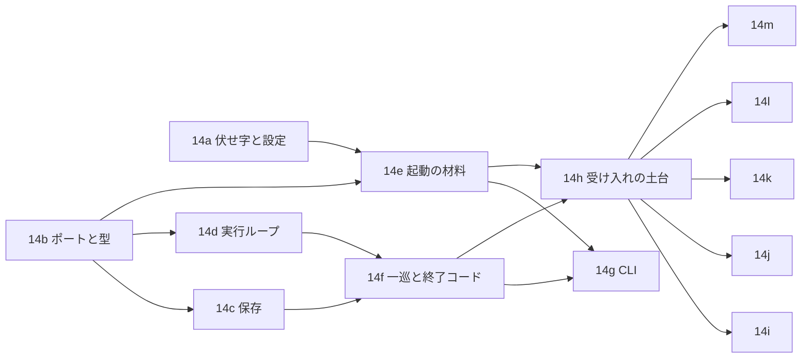

# issue #14 の分け方

issue #14(実行ループ、CLI、保存、中断、終了コード、受け入れの配線)を、並列に回せる13本の brief に分ける。
この文書は、分け方、依存、並べられる組、触るファイル、複雑度の上限に収める分け方をまとめる。
各 brief の共通の決まりは `common.md`。

## 前提(2026-10-19 に作業ブランチ `claude/stoic-hopper-jp70gf` で確かめた)

- 中核の状態機械(#12、12d)、段階(#13)、探索の記憶(#10)、問題の検出の関数(#8)、ブラウザのアダプタ(#9)、判断モデルの表と橋渡し(#7)、イベントの型(#11)、初期化のコマンド(#28)は入っている。
- `crates/webqa/src/run.rs` は #15 の仮の形のまま。`observe` はページ全体の受け口 `Whole` を本物の観測から作っている(申し送りの「12e が入ったら Whole を作る」は済んでいる)。材料はまだ `Material::plain`。
- イベントログの書き出しは、すでに `Line` を JSON の値にしてから `Redactor::json` を通している(issue #14 のコメント2件目は済んでいる)。
- `ports::Store` は `write_event` だけ、`ports::Browser` にスクリーンショットは無い。`explore::Memory` に直列化は無い。`webqa` に CLI、保存、時計、中断、終了コードは無い。`webqa-tui` に端末の画面を回す本体は無い。
- 受け入れは `判断モデルを差し替えても同じ探索ができる`(T-050)の1本だけが走る。feature の写しは `tasks/loopeng/` の版と同じ。

## 分け方

| brief | 名前 | 主に触る場所 | 台帳の行(下の層のテスト) |
|---|---|---|---|
| 14a | 伏せ字と設定の検査 | `webqa-core` の `redact/`、`config/` | なし(申し送り) |
| 14b | ポート、イベント、記録の型 | `webqa-core` の `ports.rs`、`event.rs`、`explore/file.rs`、`issue/answered.rs`、`machine/` の小さな足し、`webqa-browser` の撮影、`webqa` の骨組み | T-037 `screenshot_name_has_kind_and_step` |
| 14c | 保存 | `webqa/src/store/`、`webqa/src/replay.rs`、`webqa/tests/store.rs` | T-029、T-061、T-062、T-063、T-042(`report_matches_snapshot`)、T-051(`cost_from_usage_and_pricing`) |
| 14d | 実行ループ | `webqa/src/run.rs`、`webqa/src/run/` | T-051(`records_step_timings_with_fake_clock`)、T-080、T-098、T-099、T-107(`store_failure_stops_run`) |
| 14e | 起動の材料 | `webqa/src/setup.rs`、`clock.rs`、`logging.rs`、`webqa/tests/dotenv.rs` | なし(申し送り) |
| 14f | 1回の実行の一巡と終了コード | `webqa/src/run/session.rs`、`interrupt.rs`、`exit.rs` | T-097(`interrupt_cancels_wait_and_writes_records`)、T-100、T-101、T-102、T-103、T-104、T-105、T-107(`runtime_error_exits_three`) |
| 14g | CLI と実行ファイルのテスト | `webqa/src/cli.rs`、`main.rs`、`webqa/tests/cli.rs` | T-042、T-044、T-097、T-106、T-112 の実行ファイルの層 |
| 14h | 受け入れの土台 | `webqa/tests/acceptance.rs`、`support/`、`steps/common.rs` | T-050 の移し替え |
| 14i | 受け入れ: 1ステップ、ガードレール、負荷 | `steps/step.rs`、`steps/guard.rs`、`steps/load.rs` | 受け入れ23本 |
| 14j | 受け入れ: 終了の判定 | `steps/ending.rs` | 受け入れ28本 |
| 14k | 受け入れ: 段階、固まりとドメイン外 | `steps/stages.rs`、`steps/recovery.rs` | 受け入れ18本 |
| 14l | 受け入れ: 探索の記憶、問題の記録 | `steps/memory.rs`、`steps/issues.rs` | 受け入れ19本 |
| 14m | 受け入れ: 設定、中断、終了コード | `steps/config.rs`、`steps/interrupt.rs`、`steps/exit.rs` | 受け入れ25本(T-050 を除く) |

受け入れの113本は、feature の Rule ごとに5本の brief へ割った。
Rule ごとの数は、終了の判定28、設定と外部境界14、探索の記憶12、ガードレール11、段階9、固まりとドメイン外9、1ステップ7、問題の記録7、中断6、負荷5、終了コード5である。

## 依存と並べ方

| 段 | 並べて回す brief | 始める条件 |
|---|---|---|
| 1 | 14a、14b | なし |
| 2 | 14c、14d、14e | 14b が入っている。14e はあわせて 14a |
| 3 | 14f | 14c と 14d が入っている |
| 4 | 14g、14h | 14f と 14e が入っている |
| 5 | 14i、14j、14k、14l、14m | 14h が入っている |

段の中の brief は、触るファイルが重ならない(下の表)。
並列の数は、`docs/agents.md` のとおり `df` の空きで決める。
4段目と5段目は合わせて最大6本になるので、空きが足りなければ 14g を5段目の後へ回す。

## 触るファイルの重なり

| ファイル | 触る brief | 重ならない理由 |
|---|---|---|
| `crates/webqa-core/src/redact/`、`config/` | 14a だけ | |
| `crates/webqa-core/src/ports.rs`、`event.rs`、`explore/`、`issue/`、`machine/`、`judge.rs`(derive だけ) | 14b だけ | |
| `crates/webqa-tui/src/view.rs` | 14b だけ(1行) | |
| `crates/webqa-browser/src/` | 14b だけ | |
| `Cargo.toml`(ワークスペース) | 14a(`percent-encoding` の行)、14b(`dotenvy` の行) | 別の行で、間に3行以上ある。並べてよい |
| `crates/webqa-core/Cargo.toml` | 14a だけ | |
| `crates/webqa/Cargo.toml` | 14b だけ | 後の brief が使う依存を14bがまとめて足す |
| `Cargo.lock` | 14a、14b | 統合のときに親が `cargo update -w` で作り直す |
| `crates/webqa/src/lib.rs` | 14b だけ | 後の brief のモジュールを、説明だけのファイルで14bが先に宣言する |
| `crates/webqa/src/store.rs`、`store/` | 14b(`store.rs` と `screenshots.rs`)、14c(残り) | 段が違う |
| `crates/webqa/src/run.rs`、`run/` | 14d、14f(`session.rs` と `run.rs` の1行) | 段が違う |
| `crates/webqa/src/interrupt.rs` | 14b(trait)、14f(`guard`)、14g(`CtrlC`) | 段が違う |
| `crates/webqa/src/setup.rs`、`clock.rs`、`logging.rs` | 14b(説明だけ)、14e | 段が違う |
| `crates/webqa/src/exit.rs` | 14b(説明だけ)、14f | 段が違う |
| `crates/webqa/src/cli.rs`、`main.rs` | 14b(`cli.rs` の説明だけ)、14g | 段が違う |
| `crates/webqa/tests/support/fakes.rs` | 14b(trait の新しいメソッド)、14d(呼び出し側の直しだけ)、14h | 14b と 14d は段が違い、14d は fakes.rs に偽物を足さない |
| `crates/webqa/tests/support/world.rs`、`acceptance.rs` | 14d(`run` の引数の直しだけ)、14h | 段が違う |
| `crates/webqa/tests/steps/` | 14h(`common.rs` と T-050)、14i〜14m(Rule ごとの新しいファイル) | 5段目はファイルが別。`acceptance.rs` の `READY` は各ファイルの定数を14hが先に並べる |

5段目の5本は、手順の文言が重なると cucumber が「あいまいな手順」で失敗する。
2つ以上の Rule に出る文言は、14h が `steps/common.rs` にまとめて先に書く(14h の brief に一覧を置いた)。
5段目の担当は、自分の Rule の文言だけを書き、`{string}`、`{int}`、`{float}` 以外の広いパラメータと正規表現を使わない。
統合のたびに、親が受け入れの全シナリオを1回回し、あいまいな手順が無いことを確かめる。

## 複雑度の上限に収める分け方

上限は、関数ごとに循環的複雑度5、認知的複雑度6、Halstead の体積1000、出口4、引数7、ネスト3、50行。
ファイルごとに Halstead の体積8000。
テストのコードにも同じ上限が効く。

- 実行ループ(14d)は、効果ごとに関数を分ける。
  `run.rs` は `Ports` と `run` と `advance` だけを持つ。
  効果の実行は `run/perform.rs`、イベントの組み立ては `run/log.rs`、問題の検出とスクリーンショットは `run/detect.rs`、中核の記録(`notes`)の読み出しは `run/notes.rs` に置く。
  `select!` は腕2本で、`biased;` を付ける。
- 中断と書き終わり(14f)は、`interrupt::guard` を1つの関数にし、待つ回数を引数で受ける。
  書く順(記憶、終了のイベント、実行結果)は、`?` を1つずつ持つ3つの小さな関数にする。
- 終了コード(14f)は、`Ending` の腕3本の `match` 1つで決める。
- 保存(14c)は、ファイルの置き場所の計算、一時ファイルと名前の変更、記憶の読み込みの判定、実行結果の組み立てを別のファイルにする。
  実行結果の組み立ては、節(使用量、操作、問い合わせ、問題)ごとに関数を分ける。
- CLI(14g)は、`clap` の derive で引数を読み、サブコマンドの腕3本の `match` で振り分ける。
  起動の順(設定、判断モデル、ブラウザ、保存先、実行)は、`?` を1つずつ持つ関数に分ける。
- 受け入れ(14h〜14m)は、Rule ごとにファイルを分け、1ファイルが Halstead の上限に近づいたら `steps/<名前>/` の下に分ける。
  手順の関数は、世界(`QaWorld`)の補助を呼ぶ1〜3行にする。
  ページと答えの組み立ては `support/` の補助に寄せ、手順の中に `if` を書かない。

## 申し送りの受け持ち

`handover-14-30.md` の「#14」の節と、issue #14 のコメントを、次のように割った。

| 申し送り | 受け持つ brief | 扱い |
|---|---|---|
| CLI の起動時に作業ディレクトリの `.env` を読む(コメント1) | 14e、14g | 14e が関数を書き、14g が `main` の最初に呼ぶ |
| イベントログの書き出しを伏せ字の型に通す(コメント2) | 14d | 済んでいる形を保つ。書き出しの失敗で止めて終了コード3は 14d、14f |
| URL を出す前に伏せ字を通す(コメント3) | 14a、14c、14d | 14a が `Redactor::url` を足し、実行結果とイベントは伏せ字を通した URL だけを書く |
| `%` の符号化を戻してから照合する(コメント4) | 14a | |
| `ScreenId.path` の符号化、fragment、`/` を含む秘密(コメント5) | 14a | |
| 決め打ちシナリオで `scenario` が無ければ設定エラー | 14a | |
| `observe` の `Whole` を観測から作る | 済んでいる | 14d は今の形を保つ |
| `observe` の `Material` を観測から作る | 14d | |
| T-084 のページに要素を置く | 14j | |
| `Touch.confidence` を `Option` にするか | 変えない | 下の「親に決めてほしいこと」 |
| `run_finished.reason` と行き詰まりの種類、終了コードと `is_stuck` | 14b、14f | `reason` は serde の名前、種類は別の項目 `stuck`。終了コードは確定の問題の有無だけで決め、`is_stuck` を使わない |
| 判断モデルの判断と中核が自分で出す操作を別の種類にする | 14b、14d | `decided` と `recovered` に分ける |
| 問題の検出の呼び出しと書き出し | 14b、14d、14c | |
| 課金画面の離脱操作の名前を設定の検証で縛るか | 14a | 親が決める |
| tracing で `playwright_rs` の水準を `info` 以下に固定する | 14e | |
| `input` の対象を入力欄の系統に絞る | 14b | 親が決める |
| T-109 の2行目は応答の異常になる | 14j | |
| 判断モデルの橋渡しの時計と実行ループの時計を揃える | 14e、14g、14h | 本物の時計は開始の時刻を共有する複製を渡す。受け入れは判断モデルの偽物が待ち時間切れを `JudgeError::Timeout` で返すので、橋渡しの時計を使わない |

## 親に決めてほしいこと(全体)

各 brief の末尾にも、その brief の分を並べた。
ここには、分け方そのものに関わるものだけを置く。

1. **`webqa watch`(TUI の起動)を #14 から外すこと**。issue #14 の CLI にはサブコマンドとして挙がるが、`webqa-tui` には端末の画面を回す本体(tears の購読、描画の繰り返し)がまだ無い。案A(推す): #14 の CLI は `run`、`explore`、`replay` だけにし、`watch` は #11 の残りとして別に立てる。受け入れシナリオに `watch` は無く、#14 の完了の条件にも関わらない。案B: 14g に TUI の本体まで入れる(14g が倍の大きさになり、`webqa-tui` の依存に tears と crossterm が増える)。
2. **受け入れの「1ステップを実行する」の止め方**。cucumber の手順は実行全体を1回回すので、決めたステップ数で止める仕組みが要る。14h は、判断モデルの偽物が答えを使い切ったら待ち続け、それを合図に偽の中断が入って実行を止める形にした。止めた実行は「終了していない」として扱う。案B は、実行ループに「n 回効果を実行したら止める」引数を足すこと。製品のコードにテストのための分岐が入るので、推すのは A。
3. **13本に分けること**。14b と 14h は、ほかの brief が並列に回るための土台で、それ自体の受け入れの価値は小さい。土台を作らずに順に回すと、並列は2段目の3本だけになる。
4. **`docs/architecture.md` の追記**。この分け方で、ポートの形(`Store` のメソッド、`Browser::screenshot`)、イベントの種類、実行結果の形、実行IDの形、`--out` の引数が決まる。文書には今これらが無いか、違う形で書いてある。統合のあとに親が `writing-docs` で直す案にした。

## 決まったこと

各 brief の「親に決めてほしいこと」は、次のとおり決まった。実装はこれに従い、各 brief の論点の節よりこちらを優先する。

全体:

- `webqa watch` は #14 から外し、#11 の残りとして別の issue にする(利用者の決定)。
- 受け入れの止め方は、判断モデルの偽物が答えを使い切ったら待ち、それを合図に偽の中断で止める形にする。製品のコードに回数で止める引数を足さない。
- 13本に分ける。統合のあとに、ポートの形、イベントの種類、実行結果の形、`--out` を `docs/architecture.md` へ反映する(親が行う)。

14a:

- 課金画面の離脱操作の名前は、対象の要らない6つの名前に、設定の検査で縛る。
- URL はパス全体で照合する。外へ出す URL は `%` で符号化した形のまま書く。

14b:

- スクリーンショットは `Browser::screenshot` で撮る。
- `input` の対象はブラウザの側で入力欄に絞る。入力欄でない要素への `input` は実行せず、操作の失敗として記録し、実行は止めない。
- 記憶の JSON に `forbidden` を足す。
- 意味の判断の問いは「わかりにくい表示」の1つにし、閾値は `error_confidence` と共有する。問いは中核の列に入れず、実行ループが後ろに足す。

14c:

- 記憶のファイル名は `form_urlencoded` で符号化する。同じ実行IDのディレクトリが既にあれば失敗にする。
- 単価が無いときのコストは `None`。再実行では問いの中身を確かめない。
- 自由な文の答えに写った秘密の扱いは、この範囲の外とする(#30 と #24 が受け持つ)。

14d:

- ステップは、問い合わせと中核の操作のたびに1つ進め、最初の観測をステップ0にする。
- 同じ問題(種類、証拠、ラベルが同じもの)は、1回の実行で1回だけ記録する。
- スクリーンショットが撮れなくても実行は止めず、画像なしで問題を記録する。
- `Touch.confidence` は `f64` のままにする。

14e:

- `clock.rs` の本物の時計には、理由を書いた `#[expect(clippy::disallowed_methods)]` を付けてよい。`docs/architecture.md` の「時計」が、この1つのファイルに限って認めている例外である。ほかのファイルには付けない。
- 入力値と API キーは、自動で伏せる対象に足す。
- `.env` の変数は、ランタイムを作る前にプロセスの環境変数へ足す。診断ログの環境変数の名前は `WEBQA_LOG`。

14f:

- 中断以外の理由で終わった実行では、書いている間の1回目の中断を無視し、2回目で抜ける。
- 開始の行と記憶の読み込みの間は、中断と競わせない。終了コードに行き詰まりの種類を使わない。

14g:

- 判断モデルの起動の失敗は、種類が無い・コマンドが無いを終了コード2、起動できない・申告を返さないを3にする。
- 記録の出力先は引数 `--out` で渡す。設定には項目を足さない(利用者の決定)。
- 制限時間は設定の `limits.max_duration_secs` だけで決め、CLI の引数では上書きしない(利用者の決定)。受け入れは設定に60秒を書いて確かめる。
- ブラウザの表示領域は 1280×720 に固定する。終わったときに、終了理由と実行のディレクトリを標準エラーへ1行書く。

14h〜14k:

- 各 brief の案のとおりにする(14h の止め方と区切りの読み方、使わない補助を書かない決まり、新しい要素のクリックで変化しないステップを作ること。14i〜14k の場面の作り方と、答えの列の切り詰め、回し直しでの確かめ)。

残り:

- 14l(探索の記憶と問題の記録)と 14m(設定と外部境界、中断、終了コード)の brief は、まだ無い。14h が入ったあとに書く。
- `docs/architecture.md` の受け入れシナリオの数は、feature の Scenario の数(既存のモード113本)に合わせて直した。
