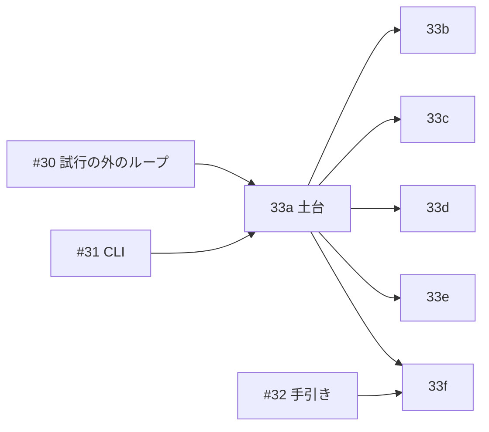

# issue #33 の分け方

issue #33(インタビューのモードの受け入れシナリオを配線する)を、土台1本と並列の5本に分ける。
この文書は、分け方、依存、並べられる組、触るファイル、共通の手順をまとめる。
各 brief の共通の決まりは `common.md`、並列に回す手順は skill `parallel-work`。

## 前提

- feature は `tasks/loopeng/InterviewMode.feature`。Rule が11、Scenario(Outline を含む)が131本ある。
- 下の層のテストは #18〜#32 が持つ。#33 は受け入れの層だけを配線する。
- 試行の外のループ(#30)、`webqa interview` と `webqa check-docs`(#31)、台帳(#24)、照らし合わせ(#25)、台帳の画面(#27)が入っていることを前提にする。
- 探索モードの受け入れ(`crates/webqa/tests/acceptance.rs`、190本)は、そのまま通らなければならない。

## 分け方

| brief | 名前 | Rule | 本数 |
|---|---|---|---|
| 33a | 受け入れの土台 | Background と共通の手順 | 0(土台の確かめだけ) |
| 33b | 入力と既存のモード | ペルソナと目的の入力、既存のモードとの関係 | 19 + 5 = 24 |
| 33c | 試行 | 試行 | 29 |
| 33d | 問いと終わり方 | 判断モデルへの問い、試行の終わり方、ペルソナから外れないこと | 14 + 7 + 6 = 27 |
| 33e | 課題と台帳 | 課題の見つけ方、台帳の書式 | 12 + 16 = 28 |
| 33f | 選択と再実行と手引き | 課題を選ぶことと TUI、再実行と照らし合わせ、手引きと形式の検査 | 7 + 11 + 5 = 23 |

合計は131本で、feature の Scenario と Scenario Outline の見出しの数に一致する。

## 依存と並べ方

| 段 | 並べて回す brief | 始める条件 |
|---|---|---|
| 1 | 33a、#32 | #30 と #31 が入っている |
| 2 | 33b、33c、33d、33e、33f | 33a が入っている。33f の手引きの3本は #32 も |

2段目の5本は、触るファイルが重ならない(下の表)。
並列の数は、メモリとディスクの空きで決める(skill `parallel-work`)。
重いビルドは同時に3本までなので、5本は3本と2本に分けて回すことが多い。

## 受け入れの実行ファイルを分ける

インタビューのモードの受け入れは、新しい実行ファイル `crates/webqa/tests/interview_acceptance.rs` で回す。
issue は既存の `acceptance.rs` で走らせると書いているが、次の理由で分ける(親に決めてほしいこと1)。

- cucumber の世界(`World`)は1つの実行ファイルに1つの型である。探索モードの `QaWorld` は1回の実行を場面として組む形で、試行と台帳を持つインタビューのモードには合わない。
- 手順の文言の名前空間が分かれる。探索モードの手順は200に近く、同じ実行ファイルに置くと、あいまいな手順(cucumber が2つの手順に当てはまると失敗する)を避ける手間が大きい。
- 探索モードの受け入れの `acceptance.rs` を一行も変えずに済むので、「そのまま通る」が確実に保てる。

偽物の部品(`support/fakes.rs`、`support/page.rs`、`support/stuck.rs` など)は、`#[path]` で読み込んで使い回す。

## 触るファイルの重なり

| ファイル | 触る brief | 重ならない理由 |
|---|---|---|
| `crates/webqa/tests/interview_acceptance.rs` | 33a(全体)、33f(最後の網羅の assert だけ) | 33a が Rule ごとのファイルと `READY` の連結を先に全部置くので、33b〜33e は触らない |
| `crates/webqa/tests/features/interview_mode.feature` | 33a だけ(写しを置く) | |
| `crates/webqa/tests/support/interview/` | 33a だけ | 2段目は補助が足りなければ NEEDS_CONTEXT で返す |
| `crates/webqa/tests/steps/interview/common.rs` | 33a だけ | 共通の文言は33a が先に書く |
| `crates/webqa/tests/steps/interview/<Rule>.rs` | 33b〜33f が自分の Rule の分だけ | ファイルが別 |
| `crates/webqa/tests/acceptance.rs`、`support/` の既存のファイル | どれも触らない | 探索モードの受け入れを守る |

## 共通の手順

2つ以上の Rule に出る文言は16個ある。33a が `steps/interview/common.rs` にまとめて先に書く。

| 文言(引数は `{string}`、`{int}`、`{float}`) | Rule の数 |
|---|---|
| インタビューのモードで実行を終える | 5 |
| 台帳を書く | 4 |
| 伏せる対象としてメールアドレスの正規表現が設定されている | 4 |
| 終了コードは {int} である | 3 |
| 目的を設定に書いていない | 3 |
| インタビューのモードで1ステップを実行する | 3 |
| インタビューのモードで実行する | 2 |
| 起動は設定エラーで失敗する | 2 |
| 目的の done_when に、ボタン {string} がページにあることが書かれている | 2 |
| その試行はゴール達成として終わっている | 2 |
| 自然さの問いの回数の上限は {int} 回に設定されている | 2 |
| 判断モデルの呼び出し上限は {int} 回に設定されている | 2 |
| 画面にメールアドレス {string} が表示されている | 2 |
| ブラウザ操作をしていない | 2 |
| 応答の異常として記録されている | 2 |
| その台帳を読み戻す | 2 |

Background の3つの Given も、33a が書く。

2段目の担当は、自分の Rule の文言だけを書く。
`{string}`、`{int}`、`{float}` 以外の広いパラメータと正規表現は使わない。
統合のたびに、親が受け入れの全シナリオを1回回し、あいまいな手順が無いことを確かめる。

## 探索モードの #14 から持ち越す注意

- 壊れたときに止まり続けるテストを書かない。`tokio::time` はこのクレートで禁止なので、待つなら std の `recv_timeout` か `tests/support/stuck.rs` を使う。止まり続けるテストは、CI の mutation の待ち時間切れになる。
- `READY` の名前の数え方は、`Scenario:` と `Scenario Outline:` の両方を数える(#14 の 14h で直した)。
- 場面の時計は、ブラウザを開く前の待ちのうち、待つ先が「今 + 初期化の待ち時間」のものを初期化の締め切りとみなす。窓が明ける時刻や制限時間がたまたまそこに一致すると取り違えるので、この一致を避けて場面を組む。
- `READY` に入れ忘れたシナリオは、黙って走らない。33f の最後に、`READY` の名前の数が feature の見出しの数と一致することを確かめる(親に決めてほしいこと3)。
- 「探索モードと決め打ちシナリオの受け入れシナリオは、そのまま通る」は `--test acceptance`(CI の check)に任せ、`READY` に入れない。名前は `steps/interview/modes.rs` の `DELEGATED` に置き、網羅の数は `READY` と `DELEGATED` を合わせて131本と数える。
- シナリオを通すために Then の確かめを緩めない。Given の場面を feature と違うものにしない。まとめてのレビューで、何も確かめずに通るシナリオを must として探す。
- 課題の番号は `I-` と16進8桁で、画面・要素・種類から計算する。feature の例の番号(`I-0001` など)は、手順の中で実際の番号に読み替える(`handover-14-30.md` の #33 の節)。
- 台帳の課題の1行目は `- [ ] I-XXXXXXXX 指示の文`。「1行目は直す指示の文」の確かめは、番号より後を指示の文として読む。

## 親に決めてほしいこと

1. **受け入れの実行ファイルを分けること**。推す案: `tests/interview_acceptance.rs` を新しく作る(理由は上)。別案は issue のとおり `acceptance.rs` に2つ目の feature を足す形で、`main` で世界の型を2つ回す。探索モードの受け入れのファイルに手を入れることになる。
2. **feature の写しの扱い**。推す案: 探索モードと同じく `tests/features/interview_mode.feature` に写し、33a の土台の確かめで、写しが `tasks/loopeng/InterviewMode.feature` と1バイトも違わないことを確かめる。写しが黙ってずれるのを防ぐ。
3. **`READY` の網羅**。推す案: 33f の最後に、`READY` の名前の数が feature の見出しの数(131)と一致することを確かめる assert を足す。それまでの段では、入っていないシナリオは走らないだけにする。
4. **33f の手引きの3本**。推す案: #32 が入ってから配線する。#32 が遅れたら、33f の残りの20本を先に入れ、手引きの3本だけ後から足す。
